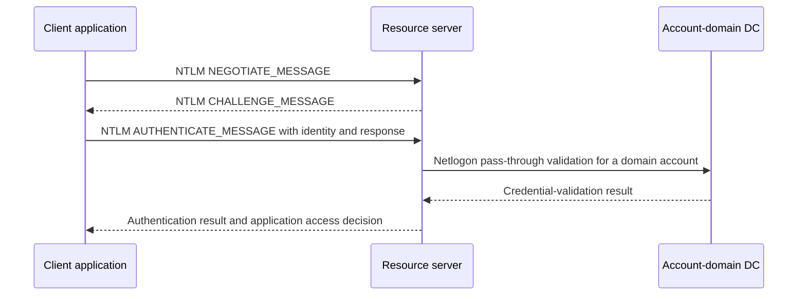
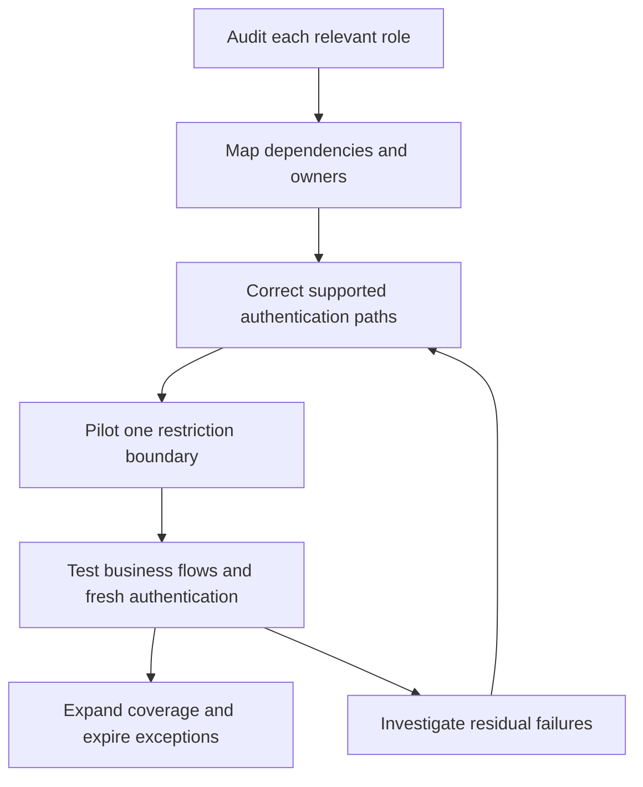

# Auditing and Reducing NTLM: Versions, Dependencies, Exceptions and Enforcement

> **Update 04/11/2026**
>
> Enhanced NTLM auditing (**402x/403x**), logging-policy screenshots and the read-only [Invoke-NtlmAudit.ps1](./Invoke-NtlmAudit.ps1) collector: **HTML, CSV and JSON**. Prerequisites below; usage in section 10.

**NTLM cleanup is an application quest, not a GPO speedrun.** Find the caller, identity and target; fix the dependency; then block.

Scope: **Windows Server 2019/2022/2025 and Windows clients**. Server 2025 removes NTLMv1; NTLMv2 is deprecated, not disabled. Keep classic evidence where enhanced logging is unavailable.

> **TL;DR**
>
> - Audit **clients + resource servers + DCs**. DC-only visibility misses dependencies.
> - `Negotiate` does not prove Kerberos; "not Kerberos" does not prove NTLM.
> - **402x/403x** add version/protection evidence and client usage reasons. **Warning != NTLMv1**.
> - **4624/4625** describe logons; **4776** describes credential validation, not the complete application flow.
> - Fix, pilot, then restrict. Exceptions need an **exact target, owner and expiry**.

## 1. Keep the versions and protections separate

| Term | Meaning and current implication |
|---|---|
| LM | Obsolete authentication/credential technology; not an acceptable compatibility target |
| NTLMv1 | Legacy challenge-response authentication; removed from Windows Server 2025 |
| NTLMv2 | Stronger challenge-response construction, but still a legacy dependency to reduce |
| LAN Manager authentication level | Controls response/version compatibility; refusing LM/NTLMv1 is not the same as blocking NTLMv2 |
| Restrict NTLM policies | Audit or restrict NTLM by outgoing, incoming or domain-validation boundary |
| Negotiate / SPNEGO | Selects a supported authentication mechanism, normally preferring Kerberos when its prerequisites are met |
| Signing, channel binding and Extended Protection | Protocol/application-specific protections; not interchangeable with replacing NTLM |

NTLMv2 is not "NTLM with TLS": authentication, signing/sealing and transport encryption are separate. Relay risks remain; Credential Guard does not erase every dependency. **Password hash != captured challenge-response; SMB version != NTLM version.**

### Enhanced audit availability

Enhanced auditing availability, per [Microsoft KB5064479](https://support.microsoft.com/en-au/servicing/os/windows/2025/07/overview-of-ntlm-auditing-enhancements-in-windows-11-version-24h2-and-windows-server-2025):

| Operating system | Enhanced NTLM audit availability |
|---|---|
| Windows 11 | Version 24H2 and later |
| Windows Server 2025 | Supported |
| Windows Server 2022 | Updates released on or after October 13, 2026 |
| Windows Server 2019 | Updates released on or after October 13, 2026 |
| Other releases or unverified builds | Verify support/provider definitions; retain classic collection |

Verify **build, updates, event definitions and effective logging**. Installed definitions do not prove that the workload was observed.

## 2. Understand the observation points

Domain account: the resource server normally asks a DC through Netlogon. Local account: the resource computer is the credential authority.



**Credential validation != application authorization.** The server creates the logon context and decides resource access.

| Observation point | Evidence | Blind spot |
|---|---|---|
| Client | 4020/4021: process, target, reason; classic outgoing events | Attempt does not prove success |
| Resource server | 4022/4023: incoming details/status; classic incoming events; Security 4624/4625 | Local server process != initiating client application |
| Domain controller | 4032/4033 or 4030/4031; classic domain audit including 8004; Security 4776 | Local-account validation may never reach a DC |

Trusts do not imply NTLM: Kerberos supports cross-realm authentication with appropriate trusts and name routing.

## 3. Deploy audit policy to the correct roles

### Classic Restrict NTLM auditing

Under **Computer Configuration > Policies > Windows Settings > Security Settings > Local Policies > Security Options**, configure the appropriate audit-only settings:

| Policy | Audit setting | Where to apply it |
|---|---|---|
| Network security: Restrict NTLM: Outgoing NTLM traffic to remote servers | Audit all | Any Windows NTLM initiator, including DCs |
| Network security: Restrict NTLM: Audit Incoming NTLM Traffic | Enable auditing for all accounts | Any Windows NTLM receiver: servers, workstations and DCs |
| Network security: Restrict NTLM: Audit NTLM authentication in this domain | Enable all | All DCs in each relevant domain; not workstations/member servers |

Scope by **role**, not machine label: servers initiate, workstations receive, DCs can do both. Domain-wide auditing is DC-only; it does not replace caller/resource evidence.

These are **audit settings, not blocks**. Incoming audit and enforcement are separate; the outgoing policy also offers **Deny**. Check the value before linking the GPO.

### Enhanced NTLM logging

Enhanced logging defaults to enabled on supported, updated systems. Its controls are separate from classic Restrict NTLM policies:

| Policy | Full GPO path | Scope |
|---|---|---|
| NTLM Enhanced Logging | Computer Configuration > Policies > Administrative Templates > System > NTLM > NTLM Enhanced Logging | Client-side and server-side enhanced logging |
| Log Enhanced Domain-wide NTLM Logs | Computer Configuration > Policies > Administrative Templates > System > Netlogon > Log Enhanced Domain-wide NTLM Logs | Domain-wide enhanced logging on DCs |

**Default enabled != verified coverage.** Check effective policy and channel state. These controls neither deny NTLM nor replace classic auditing.

#### If the settings are missing: check the ADMX source

Expand **System**, not Windows Components. Then check GPMC's Administrative Templates header:

- **Central Store:** GPMC reads SYSVOL; patching the editor or installing templates locally does not update it.
- **Local definitions:** check the editor computer's templates.

Required definitions:

| Policy | ADMX file | Internal policy name |
|---|---|---|
| NTLM Enhanced Logging | `Ntlm.admx` | `LogEnhancedNtlmAudits` |
| Log Enhanced Domain-wide NTLM Logs | `Netlogon.admx` | `Netlogon_EnhancedDomainNtlmLogs` |

Use matching ADML resources (`en-US\Ntlm.adml`, `en-US\Netlogon.adml`, or the editor's language) and consistent shared dependencies. **File present != definition present.**

Read-only check; replace `example.test`:

```powershell
$centralStore = '\\example.test\SYSVOL\example.test\Policies\PolicyDefinitions'

Select-String -LiteralPath (Join-Path $centralStore 'Ntlm.admx') `
    -SimpleMatch 'name="LogEnhancedNtlmAudits"' -ErrorAction Stop

Select-String -LiteralPath (Join-Path $centralStore 'Netlogon.admx') `
    -SimpleMatch 'name="Netlogon_EnhancedDomainNtlmLogs"' -ErrorAction Stop
```

No match: definition absent. File-read error: investigate access/path. Definition present but invisible: check ADML, editor filters and the selected DC's SYSVOL copy; reopen after updating.

Follow Microsoft's [Central Store guidance](https://learn.microsoft.com/en-us/troubleshoot/windows-client/group-policy/create-and-manage-central-store): obtain current ADMX/ADML, back up, test a consistent set, preserve vendor templates and verify SYSVOL replication. No blind replacement of `%windir%\PolicyDefinitions`; the collector never updates templates.

**Templates expose settings; OS updates supply telemetry. Neither proves the other.** GPMC's template source, not the DC OS alone, determines policy visibility.

#### Client and resource-server side: NTLM Enhanced Logging

1. Scope a computer GPO to the clients/resource servers to observe.
2. Set **NTLM Enhanced Logging** to **Enabled**, using the path above.
3. Verify effective policy and **Applications and Services Logs > Microsoft > Windows > NTLM > Operational**: **4020/4021** outgoing, **4022/4023** incoming.


The capture shows **Not Configured**. On supported builds, Enabled/Not Configured allow logging; Disabled suppresses it. Explicit Enabled avoids relying on defaults. Check section 1, not just the policy's "Supported on" label.

#### Domain-controller side: Log Enhanced Domain-wide NTLM Logs

1. Scope a computer GPO to **all relevant DCs in each domain**, not just the PDC emulator.
2. Set **Log Enhanced Domain-wide NTLM Logs** to **Enabled**.
3. Verify effective policy and **Microsoft-Windows-NTLM/Operational**: **4032/4033**, plus **4030/4031** for applicable cross-domain validation.


Also **Not Configured**: supported DCs default to logging; Disabled suppresses it. This DC-specific control is independent of the client/server setting.

For both: verify the channel, size/forward it for the observation window and test a known flow **without weakening authentication**. The collector enables neither policies nor channels.

### Security-log auditing and effective configuration

Separately configure **Advanced Audit Policy**: **Audit Logon** for Security 4624/4625 on resource systems; **Audit Credential Validation** for 4776 on credential authorities. Neither enables NTLM Operational auditing.

Check representative systems:

```powershell
Get-CimInstance -ClassName Win32_OperatingSystem |
    Select-Object Caption, Version, BuildNumber

gpresult.exe /scope computer /r
auditpol.exe /get /subcategory:"Logon"
auditpol.exe /get /subcategory:"Credential Validation"
```

English subcategory names above: use `auditpol /list /subcategory:* /v` for localized names/GUIDs. `gpresult /r` lists GPOs; use detailed results to confirm values. Coordinate with Defender for Identity/management tooling to avoid competing policies.

## 4. Verify logging before trusting an empty result

```powershell
$logName = 'Microsoft-Windows-NTLM/Operational'

Get-WinEvent -ListLog $logName -ErrorAction Stop |
    Select-Object LogName, IsEnabled, RecordCount, FileSize, MaximumSizeInBytes, LogMode

foreach ($provider in 'Microsoft-Windows-NTLM', 'Microsoft-Windows-Security-Netlogon') {
    Get-WinEvent -ListProvider $provider -ErrorAction Stop |
        Select-Object -ExpandProperty Events |
        Select-Object @{Name = 'Provider'; Expression = { $provider }}, Id, Version, Level, Template
}
```

Record channel state, retention, forwarding and build. Test an existing NTLM business flow; do not manufacture a production fallback. Read the installed manifest and XML, not an assumed universal schema. **Disabled, inaccessible, unsupported or rolled-over != zero usage.**

### Enhanced event map

Two journals, not one giant DC bucket. Events stay on the source machine unless forwarded:

| Channel | Provider and selected events |
|---|---|
| `Microsoft-Windows-NTLM/Operational` | `Microsoft-Windows-NTLM`: **4020-4023, 8001-8003**; `Microsoft-Windows-Security-Netlogon`: **4030-4033, 8004** |
| `Security` | `Microsoft-Windows-Security-Auditing`: **4776**, and **4624/4625** explicitly identifying NTLM |

Keep **provider + ID** in filters/evidence. All enhanced pairs below share NTLM Operational; each pair has the same observation point/fields but Information or Warning severity.

| Information | Warning | Observation point | What it tells you |
|---|---|---|---|
| 4020 | 4021 | Client, outgoing authentication | Initiating process/PID, account, target, NTLM version/protections and usage reason |
| 4022 | 4023 | Resource server, incoming authentication | Local process, remote client, NTLM version/protections and authentication status |
| 4032 | 4033 | DC processing same-domain validation, or the resource-server domain side of a cross-domain path | Client and server context, NTLM version/protections and validation status |
| 4030 | 4031 | Account-domain DC in a cross-domain validation path | Client/server context, forwarding DC/domain information and validation status |

**Warning != NTLMv1; Information != a green light.** Warnings can concern Extended Protection/channel binding or MIC. Read explicit version/protection fields. Client records describe attempts; server/DC statuses describe processing, not application access. Preserve status codes/namespaces: severity is not the result.

### Understand the client Usage Id/Reason

Client **4020/4021** explains NTLM selection. Keep the **numeric ID and source text**; other observation points may not supply them.

| ID | Documented reason | First investigation |
|---|---|---|
| 0 | Unknown reason | Correlate process, target and authentication evidence; do not invent a cause |
| 1 | Application called NTLM directly | Review the supported authentication API/configuration with the application owner |
| 2 | Authenticating a local account | Confirm the identity design; local accounts are not automatically migratable to domain Kerberos |
| 3 | Reserved, currently unused | Preserve as reserved; do not classify it as a failure cause |
| 4 | Authenticating a cloud account | Identify the identity and application flow before choosing a supported replacement |
| 5 | Target name missing or empty | Inspect the target name supplied by the calling application |
| 6 | Target name could not be resolved by Kerberos or other protocols | Investigate service naming, DNS, SPNs and the authentication path |
| 7 | Target name contains an IP address | Test a supported DNS/service name and its correct SPN instead of assuming IP-based Kerberos |
| 8 | Target name duplicated in Active Directory | Identify the duplicate name/SPN and its legitimate owner before correcting it |
| 9 | No line of sight to a DC | Verify DNS, routing, firewall rules and domain-controller reachability |
| 10 | NTLM called through a loopback interface | Qualify the local application flow; do not treat it automatically as remote lateral movement |
| 11 | NTLM called with a null session | Separate anonymous/null-session activity from credential-bearing authentication |

A reason is a lead, not the whole root cause. **Missing = unknown**, not unprotected. Parse named XML fields/version, not localized Message text or positional indexes; retain extras and raw XML.

### Keep classic evidence and collect a bounded window

Keep **8001-8004** alongside enhanced/Security evidence: enhanced logging does not disable classic auditing. This bounded query keeps both Operational families:

```powershell
$computer = 'app01.corp.example'
$startTime = (Get-Date).AddHours(-24)
$endTime = Get-Date

Get-WinEvent -ComputerName $computer -FilterHashtable @{
    LogName = 'Microsoft-Windows-NTLM/Operational'
    StartTime = $startTime
    EndTime = $endTime
} -ErrorAction Stop |
    Select-Object TimeCreated, Id, Version, MachineName, RecordId, Message,
        @{Name = 'EventXml'; Expression = { $_.ToXml() }}
```

Centralize a full workload cycle: jobs, failovers, admin tasks and rare applications. **One flow can produce several records** across client/server/DC; do not add them up as unique authentications.

## 5. Identify explicit NTLM logons in Security events

This helper selects Security **4624 + `AuthenticationPackageName = NTLM`** and preserves unknown subpackages:

```powershell
function Convert-NtlmLogonEvent {
    [CmdletBinding()]
    param([Parameter(Mandatory)][xml]$EventXml)

    if ([int]$EventXml.Event.System.EventID -ne 4624 -or
        $EventXml.Event.System.Provider.GetAttribute('Name') -ne 'Microsoft-Windows-Security-Auditing') {
        return
    }

    $data = @{}
    foreach ($item in $EventXml.Event.EventData.Data) {
        $data[$item.GetAttribute('Name')] = $item.InnerText
    }
    if ($data['AuthenticationPackageName'] -ne 'NTLM') { return }

    $subpackage = $data['LmPackageName']
    $versionEvidence = 'Not established'
    if ($subpackage -in 'NTLM V1', 'NTLM V2', 'LM') {
        $versionEvidence = $subpackage
    }

    [pscustomobject]@{
        TimeUtc = ([datetimeoffset]$EventXml.Event.System.TimeCreated.SystemTime).UtcDateTime
        Computer = [string]$EventXml.Event.System.Computer
        RecordId = [long]$EventXml.Event.System.EventRecordID
        Account = '{0}\{1}' -f $data['TargetDomainName'], $data['TargetUserName']
        AccountSid = $data['TargetUserSid']
        LogonType = $data['LogonType']
        LogonId = $data['TargetLogonId']
        AuthenticationPackage = $data['AuthenticationPackageName']
        RawSubpackage = $subpackage
        VersionEvidence = $versionEvidence
        SourceAddress = $data['IpAddress']
        Workstation = $data['WorkstationName']
        ProcessName = $data['ProcessName']
    }
}
```

Filter named fields on the resource server:

```powershell
$resourceServer = 'app01.corp.example'
$ntlmQuery = @'
<QueryList>
  <Query Id="0" Path="Security">
    <Select Path="Security">
      *[System[(EventID=4624) and TimeCreated[timediff(@SystemTime) &lt;= 86400000]]]
      and *[EventData[Data[@Name='AuthenticationPackageName']='NTLM']]
    </Select>
  </Query>
</QueryList>
'@

$ntlmLogons = @(Get-WinEvent -ComputerName $resourceServer -FilterXml $ntlmQuery -ErrorAction Stop |
    ForEach-Object { Convert-NtlmLogonEvent -EventXml ([xml]$_.ToXml()) })

$ntlmLogons | Group-Object Computer, Account, SourceAddress, VersionEvidence |
    Sort-Object Count -Descending | Select-Object Count, Name
```

Positive evidence, not an exhaustive detector. `Negotiate`, missing fields and paths without this event need other sources:

- `!= Kerberos` also matches unrelated/unspecified packages.
- Missing `LmPackageName` does **not** establish NTLMv1.
- Anonymous/null-session + "NTLM V1" does **not** prove a password-bearing NTLMv1 exchange.
- `LogonType = 3` means network logon, not NTLM.
- Local process != initiating client application.

Retain raw XML/context. Correlation limits: [Windows Logon Types Decoded](../../Concepts/Windows%20Logon%20Types%20Decoded%20-%20Events%204624%20and%204625.md).

## 6. Add credential-authority evidence

Domain-account validation: query relevant DCs or their central collection:

```powershell
$domainController = 'dc01.corp.example'

Get-WinEvent -ComputerName $domainController -FilterHashtable @{
    LogName = 'Security'
    ProviderName = 'Microsoft-Windows-Security-Auditing'
    Id = 4776
    StartTime = (Get-Date).AddHours(-24)
} -ErrorAction Stop |
    Select-Object TimeCreated, Id, MachineName, RecordId, Message
```

**4776 = credential validation**, result and source workstation when supplied; not a process-to-resource map. `MICROSOFT_AUTHENTICATION_PACKAGE_V1_0` **does not mean NTLMv1**.

Correlate with resource 4624/4625 and Operational records. Local accounts may be validated locally; success does not prove application access. Add supported DC 4032/4033 and account-domain cross-domain 4030/4031. **Logon IDs are not globally unique across machines.**

## 7. Turn events into an application backlog

| Field | Purpose |
|---|---|
| Caller and destination | Client/process; target name as used; actual resource/service identity, aliases/load balancers/back ends |
| Identity path | Local/domain account and trust path |
| Authentication evidence | Protocol/version, event location, raw Usage Id/Reason, processing status vs severity |
| Protections | Reported channel binding, MIC and session-key state; missing/unsupported stays unknown |
| Provenance | Source computer, channel, event ID/version, Record ID, timestamp and raw XML |
| Coverage and workload | Unreachable/disabled/unsupported sources, retention/truncation, frequency and business cycle |
| Delivery | Owner, remediation, retest, exact exception scope and expiry |

Prefer Negotiate over hard-coded NTLM, but prove names/SPN ownership, service identity and connectivity with [Troubleshooting Kerberos Authentication](../../Troubleshoot/Troubleshooting%20Kerberos%20Authentication%20-%20SPNs,%20Tickets,%20Error%20Codes%20and%20NTLM%20Fallback.md). Some Kerberos failures stop authentication rather than falling back.

Multi-hop? Use [Kerberos Delegation Explained](../../Concepts/Kerberos%20Delegation%20Explained%20-%20KCD,%20Protocol%20Transition%20and%20RBCD.md). **Unconstrained delegation is not your migration cheat code.** Some applications need a supported replacement other than Kerberos.

## 8. Restrict in stages



Pick one boundary for the pilot:

| Restriction | What it controls | Exception model |
|---|---|---|
| Outgoing NTLM on a client/server | Initiated authentication | Remote-server exceptions with documented server-name matching rules |
| Incoming NTLM on a resource server | Accepted authentication; domain/all-account choices | Scope the policy; outgoing exceptions do not bypass incoming deny |
| NTLM authentication in a domain | DC credential validation | Domain server-exception policy where applicable |

**An exception does not override another boundary's deny.** Server 2025 SMB-specific NTLM controls do not govern HTTP/SQL or every application.

Test **fresh authentication**, alternate names, service restarts and failover: existing sessions can hide new-logon failures. Keep a pilot-scoped rollback to the previous policy.

No "fix" by disabling signing/Extended Protection, sharing privileged accounts or embedding passwords. That is a security downgrade wearing a compatibility hat.

## 9. Define completion and residual risk

- Coverage includes intended systems and business cycles.
- Migrated apps demonstrably use the replacement; restrictions pass fresh-authentication tests.
- Exceptions have owners, scope and expiry.
- Unreachable hosts, local-account paths, non-Windows systems and unsupported telemetry remain explicit unknowns.
- Version reports use evidence, preserve unknowns and do not count multi-point observations as unique authentications.

**Empty query != NTLM-free. Audit != enforcement.**

## 10. Companion audit/report script

Script: [Invoke-NtlmAudit.ps1](./Invoke-NtlmAudit.ps1).

**Read-only collection, not remediation.** Only local reports are written; no audit/channel, restriction, SPN or account changes. Configure logging first (section 3).

### Prerequisites and scope

- **Host:** PowerShell **7.2+**; Windows for live collection. Remote payload: Windows PowerShell **5.1-compatible**, using the existing default WinRM endpoint/authentication.
- **Permissions:** WinRM endpoint access, OS/role CIM reads and event-log reads including Security. Event Log Readers alone does not grant WinRM access; Domain Admin is not required.
- **Explicit/local:** `ComputerName` needs no RSAT. `localhost` bypasses WinRM and uses the current identity, ignoring `Credential`.
- **Discovery:** **ActiveDirectory/RSAT** only for `AllDomainControllers`; `Get-ADDomainController -Filter *` finds all DCs/RODCs in one domain. Default domain context or explicit `Domain`; **no forest, member-server or client discovery**.
- **Offline:** bounded XML with an `<Event>` or `<Events>` root; **no EVTX**. Each file loads fully into memory, without the live-source cap.

Collection covers the three provider/channel sources in section 4, preserving templates, OS/build/role, channel state, retention and errors. Missing AD module, failed directory query, empty discovery or missing DC hostname stops before reports; no fallback scope. Individual target failures remain in partial reports.

### Network flows for remote collection

The **reporting host** launches the script and initiates these connections; it need not be a DC:

| From | To | Protocol / destination port | Purpose and scope |
|---|---|---|---|
| Reporting host | Each queried computer | **TCP 5985** | Default WinRM HTTP collection |
| Reporting host | Domain DC providing ADWS | **TCP 9389** | AD discovery only with `AllDomainControllers` |
| Reporting host | DNS resolvers | **UDP/TCP 53** | Name resolution/domain-service location |
| Reporting host | Domain controllers / KDCs | **UDP/TCP 88** | Domain Kerberos authentication |

Allow destination inbound and return traffic; **no reverse WinRM**. DNS/Kerberos are normal domain prerequisites, not an exhaustive AD/trust firewall matrix. Prefer FQDNs.

The script runs event/CIM reads **inside WinRM**: no direct SMB **445**, RPC **135**, dynamic Event Log RPC or CIM/DCOM connection. The standalone `Get-WinEvent -ComputerName` examples above instead use Event Log RPC.

**HTTPS-only is not supported by this interface:** no `UseSSL`/custom `Port`; opening **5986** alone will not work. It needs explicit script support and a valid listener/certificate.

Normal Kerberos/NTLM WinRM provides message-level encryption over HTTP. No `AllowUnencrypted`, `TrustedHosts` or certificate-validation shortcuts. Local/XML modes make no remote connections; outputs stay on the reporting host, not target admin shares.

### Parameters

| Parameter | Meaning |
|---|---|
| `ComputerName` | Explicit live targets |
| `AllDomainControllers` | All DCs/RODCs in one domain; requires ActiveDirectory |
| `Domain` | Discovery domain DNS name; otherwise the module's default context |
| `EventXmlPath` | Literal XML input paths |
| `StartTime`, `EndTime` | Inclusive bounds with offsets; default **rolling 24 hours**, ending at launch |
| `MaxEventsPerSource` | Live cap: **10000 per computer/provider/channel**, range **1-1000000**; one extra record detects truncation |
| `Credential` | Optional identity for both AD discovery and remote collection; ignored locally |
| `OutputDir` | **New** local directory; default: unique timestamp/GUID under the script's `Outputs` |
| `OpenReport` | Open HTML after saving all outputs, **including partial reports** |

Choose **one** scope: `ComputerName`, `AllDomainControllers` or `EventXmlPath`. `Domain` requires discovery. Start must precede end; end cannot exceed now + five minutes; existing output directories are rejected.

Cap reached? The newest matching records are retained and truncation is flagged. Increase the cap or shorten the window; rerun into a new directory. Neither recovers overwritten history.

### Live collection examples

From this directory, in PowerShell 7.2+:

```powershell
# Local evidence, without WinRM
.\Invoke-NtlmAudit.ps1 -ComputerName localhost -OpenReport

# All DCs in the default domain context, last 24 hours (requires RSAT)
.\Invoke-NtlmAudit.ps1 -AllDomainControllers -OpenReport

# All DCs in a specified domain, last seven days (DC-only scope)
.\Invoke-NtlmAudit.ps1 `
    -AllDomainControllers `
    -Domain 'example.test' `
    -StartTime ([datetimeoffset]::Now.AddDays(-7)) `
    -OutputDir '.\Outputs\Ntlm-DCs-Week1'

# Explicit client/resource-server/DC scope, last seven days
.\Invoke-NtlmAudit.ps1 `
    -ComputerName 'workstation01.example.test','app01.example.test','dc01.example.test' `
    -StartTime ([datetimeoffset]::Now.AddDays(-7)) `
    -EndTime ([datetimeoffset]::Now) `
    -MaxEventsPerSource 50000 `
    -OutputDir '.\Outputs\Ntlm-Week1'

# Optional remote identity; do not put a password in the command or source
$credential = Get-Credential
.\Invoke-NtlmAudit.ps1 -ComputerName 'dc01.example.test' -Credential $credential

# The same credential is used for AD discovery and WinRM collection
.\Invoke-NtlmAudit.ps1 -AllDomainControllers -Domain 'example.test' -Credential $credential
```

### Offline XML example

Use the export's actual window: the default last 24 hours can exclude older evidence.

```powershell
.\Invoke-NtlmAudit.ps1 `
    -EventXmlPath '.\client-events.xml','.\server-events.xml','.\dc-events.xml' `
    -StartTime '2026-11-01T00:00:00Z' `
    -EndTime '2026-11-04T00:00:00Z' `
    -OutputDir '.\Outputs\Ntlm-Offline'
```

**ImportedEvidenceOnly**: no proof of source reachability, logging policy, retention or export completeness.

### Outputs and interpretation

| File | Contents |
|---|---|
| `NtlmAudit.html` | Offline dashboard: coverage, versions, reasons, results, usage groups and expandable/searchable evidence |
| `Events.csv` | Normalized observations, provenance and account/process/target/version/protection fields |
| `Dependencies.csv` | Groups by observation point/source; counts, first/last seen, evidence IDs, investigation, `Unassigned` owner |
| `Coverage.csv` | Source state, supported IDs, requested/retained history, truncation and errors |
| `NtlmAudit.json` | Full scope/domain/target list, templates, coverage, dependencies, issues, raw fields/XML and rejected events |

**Read the dashboard, not the tea leaves:**

- **Browser:** offline, self-contained, UTC. Guides start collapsed; errors/retention stay visible. Technical tables build once, on opening.
- **Limits:** **500 rows per HTML table**, flagged when capped; filters search displayed rows only. Metrics/exports use all collected data. Without JavaScript, summaries/native details remain; use CSV/JSON for technical tables. Keep exports beside HTML.
- **Computers checked:** live targets, including failed/empty reads, OS, counts and limitations. Provider counts precede deduplication/parsing; not callers/authentications. Offline **Computers in imported logs** lists normalized event-machine counts, not files/contacted hosts.
- **Roles/results:** log computer != caller != destination; local process != client application. A 4776 authority need not be a DC. Attempts, NTLM processing, logon and unknown results stay separate.
- **Review required:** failures and interpretation notes are separate. Grouped notes count affected records, not authentications; one record may have several notes. Raw warnings/IDs/statuses stay intact; friendly labels retain searchable export codes.
- **Retention:** **affected logs only**, with requested start/end and oldest entry in UTC. Earlier history is **unverified**, not proof of overwriting/authentication failure.

**Parser/safety:** named XML; manifest-verified enhanced v0 (`Mic Status`, client `AvlFlags`). Retain extras/raw XML; warn on unverified event versions. Deduplicate identical provenance/payload; conflicts go to `RejectedEvents`; never merge observation points heuristically. Escape HTML, prefix formula-like CSV values with an apostrophe; preserve JSON originals.

**Coverage is not compliance:** `AuditPolicyCoverage = NotVerified`; reads do not prove continuous logging. Collection is non-atomic: reconcile clocks, duration and workload/failover cycles. `Collected` means no recorded gaps, not NTLM-free; `Partial` includes every offline assessment. Missing version/protection fields stay unknown; anonymous activity alone does not prove credential-bearing NTLMv1.

| Outcome | Behavior |
|---|---|
| Unreachable/unauthorized target, XML import or event-normalization error | Continue remaining inputs; save partial outputs and warnings; **`-OpenReport` still opens HTML**; exit **1** |
| Retention/truncation, disabled/unsupported source or interpretation caution without errors | Warnings/`Partial`; exit **0** when `ErrorCount = 0`, not a clean bill of health |
| Invalid input, discovery failure, report-write or report-open failure | Terminating error; no fake-success fallback |

Direct invocation returns the result object and sets `$LASTEXITCODE`; `pwsh -File` uses the same process exit code. Dot-sourced `Invoke-NtlmAuditRun` callers must inspect **`ErrorCount` and `Status`**.

**Protect the reports:** identities, process paths, machine names, IPs and raw XML belong in controlled storage, not public posts.

### Validation

[Tests/Invoke-NtlmAudit.Tests.ps1](./Tests/Invoke-NtlmAudit.Tests.ps1): synthetic XML, mocked discovery/collection and child-process exit-code checks. Pester 3.4 on PowerShell 7; no production data/domain queries.

```powershell
Import-Module Pester -RequiredVersion 3.4.0
Invoke-Pester -Script '.\Tests\Invoke-NtlmAudit.Tests.ps1'
```

Coverage: discovery/credentials/scopes, normalization/providers/filters, caps, partial failures, exit codes, dashboard metrics/labels/escaping and complete exports. **Not a live WinRM or migration certification.** Pilot supported builds and real XML/status values before enforcement.

## References

- [Enhanced NTLM auditing - OS availability, policies, event pairs and usage reasons (KB5064479)](https://support.microsoft.com/en-au/servicing/os/windows/2025/07/overview-of-ntlm-auditing-enhancements-in-windows-11-version-24h2-and-windows-server-2025)
- [Create and manage the Group Policy Central Store and Windows ADMX/ADML packages](https://learn.microsoft.com/en-us/troubleshoot/windows-client/group-policy/create-and-manage-central-store)
- [NTLM overview](https://learn.microsoft.com/en-us/windows-server/security/kerberos/ntlm-overview)
- [Windows Server removed and deprecated features](https://learn.microsoft.com/en-us/windows-server/get-started/removed-deprecated-features-windows-server)
- [Audit NTLM authentication in this domain](https://learn.microsoft.com/en-us/windows/security/threat-protection/security-policy-settings/network-security-restrict-ntlm-audit-ntlm-authentication-in-this-domain)
- [Audit incoming NTLM traffic](https://learn.microsoft.com/en-us/windows/security/threat-protection/security-policy-settings/network-security-restrict-ntlm-audit-incoming-ntlm-traffic)
- [Outgoing NTLM traffic policy](https://learn.microsoft.com/en-us/windows/security/threat-protection/security-policy-settings/network-security-restrict-ntlm-outgoing-ntlm-traffic-to-remote-servers)
- [Windows event auditing and NTLM collection for Defender for Identity](https://learn.microsoft.com/en-us/defender-for-identity/deploy/configure-windows-event-collection)
- [Event 4624](https://learn.microsoft.com/en-us/windows/security/threat-protection/auditing/event-4624)
- [Event 4776](https://learn.microsoft.com/en-us/windows/security/threat-protection/auditing/event-4776)