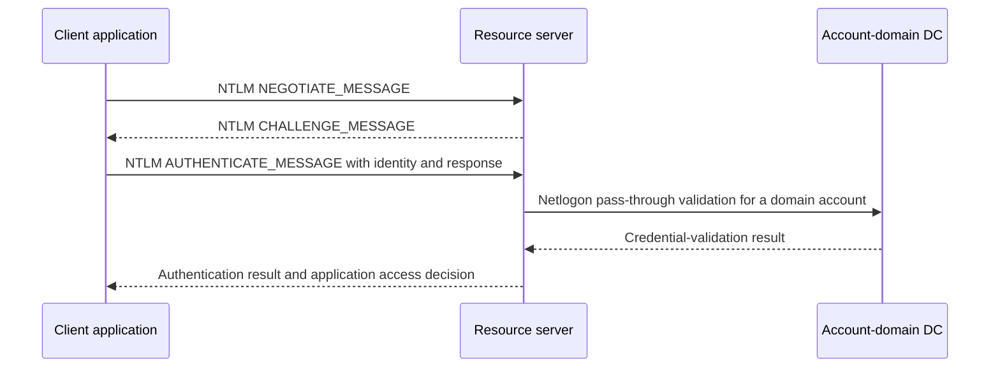
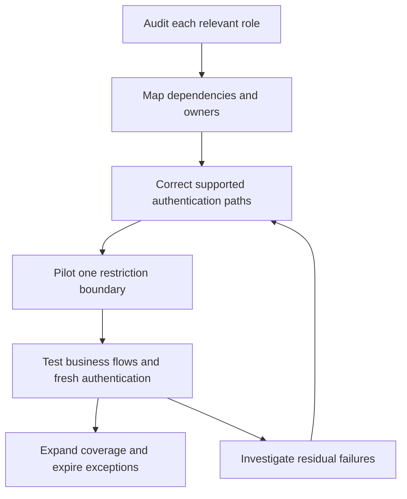

# Auditing and Reducing NTLM: Versions, Dependencies, Exceptions and Enforcement

> **Update 04/11/2026**
>
> This revision adds the enhanced NTLM audit events **4020/4021, 4022/4023, 4030/4031 and 4032/4033**, their OS/update prerequisites, logging policies and client-side usage reasons. Enhanced and classic auditing are complementary paths for a mixed estate.
>
> The companion [Invoke-NtlmAudit.ps1](./Invoke-NtlmAudit.ps1) now collects evidence and generates **HTML, CSV and JSON** reports, either from explicitly named Windows computers or exported event XML. Section 10 documents prerequisites, usage and limitations. The client/server and DC logging procedures below include Group Policy captures.

**An NTLM reduction project is an application-dependency project, not a registry-setting contest.** Before blocking authentication, identify which client, process, identity and target still use it, why Kerberos or another supported mechanism is not used, and how the owner will remove that dependency.

This guide covers Windows Server 2019, 2022 and 2025 environments and their Windows clients, with enhanced auditing on supported, updated systems and classic evidence where enhanced telemetry is unavailable. Version and patch level matter: Windows Server 2025 removes NTLMv1, while NTLMv2 remains available despite being deprecated. Deprecation does not mean that all NTLM authentication has already been disabled.

> **TL;DR**
>
> - Audit clients, resource servers and domain controllers; no single event source sees every NTLM flow.
> - `Negotiate` is a protocol selector, not proof of Kerberos. Conversely, "not Kerberos" is not sufficient evidence of NTLM.
> - In event 4624, explicitly select `AuthenticationPackageName = NTLM` and retain the NTLM subpackage when reported.
> - Event 4776 records credential validation at the account authority. It does not reliably identify the application server or distinguish NTLMv1 from NTLMv2.
> - Audit-only Restrict NTLM policies write to the NTLM Operational log; they are separate from Security-log audit subcategories.
> - Enhanced events add explicit version/protection fields and, on clients, a **Usage Id/Reason** explaining why NTLM was selected. A Warning event is not automatically proof of NTLMv1.
> - Remediate dependencies, pilot one restriction boundary, then expand. Exceptions need an exact target, owner and expiry.

## 1. Keep the versions and protections separate

| Term | Meaning and current implication |
|---|---|
| LM | Obsolete authentication/credential technology; not an acceptable compatibility target |
| NTLMv1 | Legacy challenge-response authentication; removed from Windows Server 2025 |
| NTLMv2 | Stronger challenge-response construction, but still a legacy dependency to reduce |
| LAN Manager authentication level | Controls response/version compatibility; refusing LM/NTLMv1 is not the same as blocking NTLMv2 |
| Restrict NTLM policies | Audit or restrict NTLM by outgoing, incoming or domain-validation boundary |
| Negotiate / SPNEGO | Selects a supported authentication mechanism, normally preferring Kerberos when its prerequisites are met |
| Signing, channel binding and Extended Protection | Protocol/application-specific protections; not interchangeable with replacing NTLM |

NTLMv2 is not simply "NTLM with TLS". Authentication, message signing/sealing and transport encryption are different properties. Keeping NTLMv2 does not automatically solve relay risks, and enabling Credential Guard does not remove every NTLM use.

Do not confuse the NT password hash with a captured NTLM challenge-response, or NTLM version with SMB version. A current SMB connection can still authenticate with NTLM.

### Enhanced audit availability

The availability list in [Microsoft KB5064479](https://support.microsoft.com/en-au/servicing/os/windows/2025/07/overview-of-ntlm-auditing-enhancements-in-windows-11-version-24h2-and-windows-server-2025), checked for this revision, identifies:

| Operating system | Enhanced NTLM audit availability |
|---|---|
| Windows 11 | Version 24H2 and later |
| Windows Server 2025 | Supported |
| Windows Server 2022 | Updates released on or after October 13, 2026 |
| Windows Server 2019 | Updates released on or after October 13, 2026 |
| Other releases or unverified builds | Do not assume enhanced support; retain classic collection and verify the source provider and current release-specific documentation |

Record the actual OS build and installed updates, then verify the event definitions and effective logging on each role. An event definition being installed is not proof that logging is enabled or that the observation window contains the relevant workload. An updated ADMX central store does not add telemetry support to an older endpoint.

## 2. Understand the observation points

For a domain identity, the resource server normally uses Netlogon pass-through validation to an appropriate DC. For a local account, the resource computer's local account database is the authority.



The DC validates the domain credential; the server still creates the relevant logon context and performs resource authorization. A successful validation is not proof that the application granted access.

| Observation point | Evidence | Blind spot |
|---|---|---|
| Client | Enhanced 4020/4021 with process, target and usage reason; classic outgoing NTLM Operational events | An outgoing attempt does not prove that authentication or application access succeeded |
| Resource server | Enhanced 4022/4023 with incoming authentication details and status; classic incoming events and Security 4624/4625 | The server's process is not necessarily the initiating application on the client |
| Domain controller | Enhanced 4032/4033 or 4030/4031 according to the domain path; classic domain audit including 8004 where configured, and Security 4776 | Local-account validation on a member server need not reach a DC |

Cross-domain validation can traverse trust relationships. Do not assume that a trust requires NTLM or that every cross-forest operation uses it. Kerberos supports cross-realm authentication through appropriate trusts and name routing.

## 3. Deploy audit policy to the correct roles

### Classic Restrict NTLM auditing

Under **Computer Configuration > Policies > Windows Settings > Security Settings > Local Policies > Security Options**, configure the appropriate audit-only settings:

| Policy | Audit setting | Where to apply it |
|---|---|---|
| Network security: Restrict NTLM: Outgoing NTLM traffic to remote servers | Audit all | Windows clients and servers that initiate connections, including DCs when they act as clients |
| Network security: Restrict NTLM: Audit Incoming NTLM Traffic | Enable auditing for all accounts | Servers and Windows clients that accept NTLM connections, including workstations hosting SMB shares or other network services, and DCs acting as resource servers |
| Network security: Restrict NTLM: Audit NTLM authentication in this domain | Enable all | All DCs in each relevant domain only; not workstations or member servers |

**Deployment rule: audit the initiating machine, the receiving machine and the domain credential authority, not only the DCs.** A computer can have several roles: a server can initiate outbound connections, a workstation can accept inbound connections, and a DC can do both in addition to validating domain credentials. Apply the corresponding policies to each role; do not treat all three settings as DC-only or deploy the domain-wide setting as a client audit policy.

**A DC-only rollout is insufficient.** Domain validation does not reliably identify the initiating client process or the complete application target, and authentication with a resource computer's local accounts may never reach a DC. Keep client/server collection alongside domain-controller evidence.

These settings do not block NTLM. Incoming audit and incoming enforcement are separate policies. The outgoing policy combines Allow, Audit and Deny choices, so verify the selected value before linking the GPO.

### Enhanced NTLM logging

On supported, updated systems, Microsoft documents enhanced events as enabled by default. Their logging policies are separate from the classic Restrict NTLM settings:

| Policy | Full GPO path | Scope |
|---|---|---|
| NTLM Enhanced Logging | Computer Configuration > Policies > Administrative Templates > System > NTLM > NTLM Enhanced Logging | Client-side and server-side enhanced logging |
| Log Enhanced Domain-wide NTLM Logs | Computer Configuration > Policies > Administrative Templates > System > Netlogon > Log Enhanced Domain-wide NTLM Logs | Domain-wide enhanced logging on DCs |

Use the applicable administrative templates to manage these policies, and check their effective configuration and the NTLM Operational channel on the source machines. Do not equate "default enabled" with confirmed estate-wide coverage. These are logging controls, not NTLM deny policies, and they do not replace the classic audit policies on systems that need them.

#### If the settings are missing: check the ADMX source

First expand **System**, not Windows Components or Windows Settings. If the policies are still absent, check the Administrative Templates header in the editor:

- **Policy definitions retrieved from the central store:** GPMC uses the domain's SYSVOL Central Store, not the management machine's local templates. Updating Windows or installing templates locally does not automatically update that store.
- **Local policy definitions:** check the templates supplied on the computer running the editor.

The policy definitions verified in the Windows templates are:

| Policy | ADMX file | Internal policy name |
|---|---|---|
| NTLM Enhanced Logging | `Ntlm.admx` | `LogEnhancedNtlmAudits` |
| Log Enhanced Domain-wide NTLM Logs | `Netlogon.admx` | `Netlogon_EnhancedDomainNtlmLogs` |

Both require the corresponding language resources, such as `en-US\Ntlm.adml` and `en-US\Netlogon.adml`, or the appropriate resources for the editor's language. Shared template dependencies must also remain consistent. An existing `Ntlm.admx` or `Netlogon.admx` file is not proof that its version includes these new definitions.

Read-only Central Store checks, replacing `example.test` with the actual domain:

```powershell
$centralStore = '\\example.test\SYSVOL\example.test\Policies\PolicyDefinitions'

Select-String -LiteralPath (Join-Path $centralStore 'Ntlm.admx') `
    -SimpleMatch 'name="LogEnhancedNtlmAudits"' -ErrorAction Stop

Select-String -LiteralPath (Join-Path $centralStore 'Netlogon.admx') `
    -SimpleMatch 'name="Netlogon_EnhancedDomainNtlmLogs"' -ErrorAction Stop
```

No match means that policy definition is absent from the file checked. A missing/inaccessible-file error is a different condition and must be investigated. If the definitions exist but are not displayed, check matching ADML resources, Administrative Templates filters and the SYSVOL copy used by the selected DC; reopen the editor after a validated template update.

For missing definitions, follow Microsoft's [Central Store management guidance](https://learn.microsoft.com/en-us/troubleshoot/windows-client/group-policy/create-and-manage-central-store) and obtain a current Windows ADMX package containing them. Back up the existing store, test a consistent template/resource set, preserve application/vendor templates, and verify SYSVOL replication before relying on all editors to display the new settings. Do not blindly replace files in `%windir%\PolicyDefinitions` or update SYSVOL from this audit script.

**Two independent prerequisites:** ADMX/ADML updates make a policy visible/configurable; supported OS builds and cumulative updates make enhanced events available on the target. Missing policies do not prove that the target cannot log, and visible policies do not prove target support. The DC OS alone does not determine which settings GPMC can display.

#### Client and resource-server side: NTLM Enhanced Logging

1. Edit a computer GPO scoped to the Windows clients and resource servers to observe.
2. Open **Computer Configuration > Policies > Administrative Templates > System > NTLM > NTLM Enhanced Logging**.
3. Set the policy to **Enabled** to explicitly maintain enhanced logging, then apply the GPO through the normal change process.
4. Verify the effective computer policy and inspect **Applications and Services Logs > Microsoft > Windows > NTLM > Operational** on representative machines. Client-side events are **4020/4021**; incoming server-side events are **4022/4023**.


The capture shows **Not Configured**, not an already enabled deployment. As the policy help explains, **Enabled** and **Not Configured** allow the new logs to be generated on supported systems; **Disabled** prevents them. Configuring Enabled explicitly avoids relying on an inherited/default state. The policy's "Supported on" label is not a substitute for checking the OS/update availability table in section 1.

#### Domain-controller side: Log Enhanced Domain-wide NTLM Logs

1. Edit a computer GPO scoped to the relevant domain controllers in each domain.
2. Open **Computer Configuration > Policies > Administrative Templates > System > Netlogon > Log Enhanced Domain-wide NTLM Logs**.
3. Set the policy to **Enabled**, then apply and verify it on all DCs in the observation scope, not only the PDC emulator.
4. Inspect the same **Microsoft-Windows-NTLM/Operational** channel for **4032/4033** and, where cross-domain validation applies, **4030/4031**.


This capture also shows **Not Configured**. The help text states that **Enabled** logs the new domain-wide events, **Disabled** suppresses them, and **Not Configured** defaults to logging them on supported DCs. Apply the DC-specific policy independently of the client/server setting. Neither setting enables NTLM restrictions or proves that a particular business flow has been observed.

Both procedures assume the channel is enabled and retained long enough. Check the channel separately, size/forward it for the observation window, and verify a known existing flow without weakening authentication. The audit/report script does not activate either policy or enable event channels.

### Security-log auditing and effective configuration

Also enable the relevant **Advanced Audit Policy** subcategories: Audit Logon for 4624/4625 on resource systems, and Audit Credential Validation for 4776 on credential authorities. These Security-log policies do not enable the NTLM Operational provider's audit policy by themselves.

Read the build and effective policy from representative systems:

```powershell
Get-CimInstance -ClassName Win32_OperatingSystem |
    Select-Object Caption, Version, BuildNumber

gpresult.exe /scope computer /r
auditpol.exe /get /subcategory:"Logon"
auditpol.exe /get /subcategory:"Credential Validation"
```

The subcategory names above are English display names. On localized systems, use `auditpol /list /subcategory:* /v` to identify names or GUIDs. The `gpresult /r` summary identifies applied GPOs; inspect the effective setting in a detailed Group Policy result when confirming a particular value.

Audit all relevant DCs, not only the PDC emulator. Existing Defender for Identity or other management tooling may already configure auditing; compare effective settings and avoid competing policy sources. A policy configured on one DC is not an estate-wide observation window.

## 4. Verify logging before trusting an empty result

```powershell
$logName = 'Microsoft-Windows-NTLM/Operational'

Get-WinEvent -ListLog $logName -ErrorAction Stop |
    Select-Object LogName, IsEnabled, RecordCount, FileSize, MaximumSizeInBytes, LogMode

foreach ($provider in 'Microsoft-Windows-NTLM', 'Microsoft-Windows-Security-Netlogon') {
    Get-WinEvent -ListProvider $provider -ErrorAction Stop |
        Select-Object -ExpandProperty Events |
        Select-Object @{Name = 'Provider'; Expression = { $provider }}, Id, Version, Level, Template
}
```

Record channel availability, retention, forwarding and the OS build. Verify collection against a known business flow that currently uses NTLM, without weakening its authentication policy. Do not create a production fallback dependency merely to generate an event.

Read the provider metadata and event XML for the target build instead of imposing one hard-coded schema on every machine. A channel that is disabled, inaccessible or rolled over is missing evidence, not proof of zero NTLM use. Record unsupported event families separately from supported families with no events observed.

### Enhanced event map

All the following events are in **Microsoft-Windows-NTLM/Operational**. Each pair represents the same observation point and field set, split by Information or Warning severity.

The channel is shared, but the provider is not: installed Windows event manifests identify **Microsoft-Windows-NTLM** for 4020-4023 and classic 8001-8003, and **Microsoft-Windows-Security-Netlogon** for 4030-4033 and classic 8004. Keep both provider and event ID in collection filters and normalized evidence.

| Information | Warning | Observation point | What it tells you |
|---|---|---|---|
| 4020 | 4021 | Client, outgoing authentication | Initiating process/PID, account, target, NTLM version/protections and usage reason |
| 4022 | 4023 | Resource server, incoming authentication | Local process, remote client, NTLM version/protections and authentication status |
| 4032 | 4033 | DC processing same-domain validation, or the resource-server domain side of a cross-domain path | Client and server context, NTLM version/protections and validation status |
| 4030 | 4031 | Account-domain DC in a cross-domain validation path | Client/server context, forwarding DC/domain information and validation status |

**Warning does not mean "NTLMv1 confirmed".** Warning events can also reflect missing or insecure Extended Protection/channel binding or MIC-related protections. Read the explicit NTLM Version and protection fields. Conversely, Information does not mean NTLM is the desired long-term authentication mechanism.

Client events describe attempts. Server and DC status fields describe their respective processing results, not application authorization. Preserve the status code and its namespace; an event's severity is not its success/failure result.

### Understand the client Usage Id/Reason

The client-side 4020/4021 events expose why NTLM was used. Keep both the numeric reason and its source text; this field is not available at every observation point.

| ID | Documented reason | First investigation |
|---|---|---|
| 0 | Unknown reason | Correlate process, target and authentication evidence; do not invent a cause |
| 1 | Application called NTLM directly | Review the supported authentication API/configuration with the application owner |
| 2 | Authenticating a local account | Confirm the identity design; local accounts are not automatically migratable to domain Kerberos |
| 3 | Reserved, currently unused | Preserve as reserved; do not classify it as a failure cause |
| 4 | Authenticating a cloud account | Identify the identity and application flow before choosing a supported replacement |
| 5 | Target name missing or empty | Inspect the target name supplied by the calling application |
| 6 | Target name could not be resolved by Kerberos or other protocols | Investigate service naming, DNS, SPNs and the authentication path |
| 7 | Target name contains an IP address | Test a supported DNS/service name and its correct SPN instead of assuming IP-based Kerberos |
| 8 | Target name duplicated in Active Directory | Identify the duplicate name/SPN and its legitimate owner before correcting it |
| 9 | No line of sight to a DC | Verify DNS, routing, firewall rules and domain-controller reachability |
| 10 | NTLM called through a loopback interface | Qualify the local application flow; do not treat it automatically as remote lateral movement |
| 11 | NTLM called with a null session | Separate anonymous/null-session activity from credential-bearing authentication |

A reason is an observed selection condition, not always the complete root cause. Missing fields are unknown, not proof that a protection is absent. Parse named XML fields for the installed event version, not localized Message text or positional property indexes; retain unmapped fields and raw XML.

### Keep classic evidence and collect a bounded window

The classic Operational events include the **8001-8004** family. They remain useful alongside enhanced events and Security 4624/4625/4776. Enabling enhanced logging does not disable classic auditing.

Collect a bounded interval from one source. This query intentionally keeps both classic and enhanced Operational events rather than filtering a mixed estate down to one event family:

```powershell
$computer = 'app01.corp.example'
$startTime = (Get-Date).AddHours(-24)
$endTime = Get-Date

Get-WinEvent -ComputerName $computer -FilterHashtable @{
    LogName = 'Microsoft-Windows-NTLM/Operational'
    StartTime = $startTime
    EndTime = $endTime
} -ErrorAction Stop |
    Select-Object TimeCreated, Id, Version, MachineName, RecordId, Message,
        @{Name = 'EventXml'; Expression = { $_.ToXml() }}
```

For a migration inventory, centralize collection and cover the actual workload cycle: scheduled jobs, failover paths, administrative tasks and rarely used applications. Do not sum client, server and DC event counts as though they were independent authentication attempts; one flow can appear at multiple points.

## 5. Identify explicit NTLM logons in Security events

The following helper accepts only Security event 4624 with an explicit NTLM authentication package. It retains unknown subpackage values rather than silently classifying them as NTLMv1 or NTLMv2:

```powershell
function Convert-NtlmLogonEvent {
    [CmdletBinding()]
    param([Parameter(Mandatory)][xml]$EventXml)

    if ([int]$EventXml.Event.System.EventID -ne 4624 -or
        $EventXml.Event.System.Provider.GetAttribute('Name') -ne 'Microsoft-Windows-Security-Auditing') {
        return
    }

    $data = @{}
    foreach ($item in $EventXml.Event.EventData.Data) {
        $data[$item.GetAttribute('Name')] = $item.InnerText
    }
    if ($data['AuthenticationPackageName'] -ne 'NTLM') { return }

    $subpackage = $data['LmPackageName']
    $versionEvidence = 'Not established'
    if ($subpackage -in 'NTLM V1', 'NTLM V2', 'LM') {
        $versionEvidence = $subpackage
    }

    [pscustomobject]@{
        TimeUtc = ([datetimeoffset]$EventXml.Event.System.TimeCreated.SystemTime).UtcDateTime
        Computer = [string]$EventXml.Event.System.Computer
        RecordId = [long]$EventXml.Event.System.EventRecordID
        Account = '{0}\{1}' -f $data['TargetDomainName'], $data['TargetUserName']
        AccountSid = $data['TargetUserSid']
        LogonType = $data['LogonType']
        LogonId = $data['TargetLogonId']
        AuthenticationPackage = $data['AuthenticationPackageName']
        RawSubpackage = $subpackage
        VersionEvidence = $versionEvidence
        SourceAddress = $data['IpAddress']
        Workstation = $data['WorkstationName']
        ProcessName = $data['ProcessName']
    }
}
```

Use a named-field filter on the resource server, then normalize the results:

```powershell
$resourceServer = 'app01.corp.example'
$ntlmQuery = @'
<QueryList>
  <Query Id="0" Path="Security">
    <Select Path="Security">
      *[System[(EventID=4624) and TimeCreated[timediff(@SystemTime) &lt;= 86400000]]]
      and *[EventData[Data[@Name='AuthenticationPackageName']='NTLM']]
    </Select>
  </Query>
</QueryList>
'@

$ntlmLogons = @(Get-WinEvent -ComputerName $resourceServer -FilterXml $ntlmQuery -ErrorAction Stop |
    ForEach-Object { Convert-NtlmLogonEvent -EventXml ([xml]$_.ToXml()) })

$ntlmLogons | Group-Object Computer, Account, SourceAddress, VersionEvidence |
    Sort-Object Count -Descending | Select-Object Count, Name
```

This is a useful positive-evidence query, not an exhaustive NTLM detector. `Negotiate`, missing fields and authentication paths that do not create the selected event require other evidence. In particular:

- `AuthenticationPackageName != Kerberos` also matches unrelated or unspecified packages.
- A missing `LmPackageName` is not proof of NTLMv1.
- Anonymous/null-session records need separate interpretation; an NTLM V1 label in such a record is not sufficient proof of an NTLMv1 password exchange.
- `LogonType = 3` means a network logon, not a specific authentication protocol.
- The event's local process field is not necessarily the client application that initiated the connection.

Keep the raw XML and collection context for ambiguous records. See [Windows Logon Types Decoded](../../Concepts/Windows%20Logon%20Types%20Decoded%20-%20Events%204624%20and%204625.md) for event roles and correlation limits.

## 6. Add credential-authority evidence

For domain-account validation, query the relevant DCs or their central event collection:

```powershell
$domainController = 'dc01.corp.example'

Get-WinEvent -ComputerName $domainController -FilterHashtable @{
    LogName = 'Security'
    ProviderName = 'Microsoft-Windows-Security-Auditing'
    Id = 4776
    StartTime = (Get-Date).AddHours(-24)
} -ErrorAction Stop |
    Select-Object TimeCreated, Id, MachineName, RecordId, Message
```

Event 4776 identifies credential validation and its result, with a source workstation when supplied. It does not provide the complete source-process-to-resource mapping. Its `MICROSOFT_AUTHENTICATION_PACKAGE_V1_0` package name is **not a statement that NTLMv1 was used**.

Correlate it with resource-side 4624/4625 and NTLM Operational events. Local accounts can be validated by the resource computer instead of a domain DC. A successful validation does not establish that a share, database or web application authorized the request.

On supported DCs, add 4032/4033 and, for the account-domain side of cross-domain validation, 4030/4031. They enrich the domain path; they do not make client and resource-server collection redundant. Do not assume a Logon ID is a globally unique identifier across machines.

## 7. Turn events into an application backlog

| Field | Purpose |
|---|---|
| Client and initiating process, when known | Identifies what must change |
| Target name as used by the client | Exposes IP addresses, aliases and name mismatches |
| Actual resource server and service identity | Separates namespace, load balancer and back-end roles |
| Identity authority | Distinguishes local accounts, domain accounts and trust paths |
| Protocol/version evidence and event locations | Documents what is known rather than inferred |
| Client Usage Id/Reason and raw description, when present | Records the observed selection condition and guides investigation without guessing from a DC event |
| Authentication/validation status, separate from event severity | Separates attempts, successful or failed processing, and Warning-level protection findings |
| Reported channel binding, MIC and session-key state | Retains protection evidence, with missing/unsupported values kept as unknown |
| Source computer, channel, event ID/version, Record ID and timestamp | Provides provenance and helps correlate observations without counting them as independent authentications |
| Collection coverage and gaps | Distinguishes no observed usage from inaccessible, disabled, unsupported or incomplete telemetry |
| Frequency and business cycle | Captures intermittent dependencies |
| Owner, remediation and retest | Makes the finding actionable |
| Exception scope and expiry | Prevents compatibility allowances becoming permanent |

Typical causes include hard-coded NTLM APIs, access by IP address, missing/incorrect SPNs, service-account changes, local accounts, absent domain connectivity and applications whose supported authentication design is not Kerberos.

Using Negotiate is generally preferable to explicitly selecting NTLM, but it does not guarantee Kerberos. Correct names and SPN ownership, service identity and connectivity must also be in place. Some Kerberos failures terminate authentication instead of safely falling back.

Use [Troubleshooting Kerberos Authentication](../../Troubleshoot/Troubleshooting%20Kerberos%20Authentication%20-%20SPNs,%20Tickets,%20Error%20Codes%20and%20NTLM%20Fallback.md) to prove the intended replacement flow before denying the existing one.

Where Kerberos is the intended solution, use [Kerberos Delegation Explained](../../Concepts/Kerberos%20Delegation%20Explained%20-%20KCD,%20Protocol%20Transition%20and%20RBCD.md) for multi-hop applications. Enabling unconstrained delegation is not an NTLM migration strategy.

## 8. Restrict in stages



Choose the boundary deliberately:

| Restriction | What it controls | Exception model |
|---|---|---|
| Outgoing NTLM on a client/server | Authentication initiated by that machine | Companion remote-server exception policy, using the documented server-name matching rules |
| Incoming NTLM on a resource server | Authentication accepted by that server, with domain/all-account choices | Scope the deployment and selected policy; do not assume outgoing exceptions bypass an incoming deny |
| NTLM authentication in a domain | Validation handled by the domain's DCs | Companion domain server-exception policy for applicable cases |

An exception at one boundary does not override a denial at another. Windows Server 2025 also has SMB-specific NTLM controls; evaluate them as a separate protocol scope rather than assuming they govern HTTP, SQL and every other application.

Test fresh authentication, alternate client names, service restarts and failover paths. Existing sessions can remain usable even when new logons are blocked. Keep a defined rollback to the previous policy for the affected pilot, not a domain-wide change that obscures the failing dependency.

Do not replace an NTLM exception with disabled signing, disabled Extended Protection, a shared privileged account or credentials embedded in a script. Such changes trade one authentication problem for a broader security problem.

## 9. Define completion and residual risk

Completion means that collection covers the intended systems and business cycles, migrated applications use their intended authentication mechanism, restrictions behave as tested, and remaining exceptions are explicit and time-bound.

An empty DC query does not mean the environment is NTLM-free. Retain coverage failures, local-account paths, non-Windows systems and unsupported telemetry as separate unknowns. Audit mode provides visibility; it is not enforcement.

Use explicit version evidence when reporting NTLMv1/NTLMv2, and keep an unknown-version category. Do not label every enhanced Warning as NTLMv1 or treat duplicate observations across client/server/DC channels as distinct dependencies.

## 10. Companion audit/report script

Script: [Invoke-NtlmAudit.ps1](./Invoke-NtlmAudit.ps1).

This is a **read-only collector and reporter**, not a remediation tool. It does not change audit policies, enable channels, alter NTLM restrictions, edit SPNs or modify accounts. Only the local report directory is created/written. Configure and verify logging separately using section 3.

### Prerequisites and scope

- **Reporting host:** PowerShell **7.2 or later**. Live collection requires Windows; offline XML analysis does not query Windows event logs.
- **Remote targets:** Windows with PowerShell Remoting/WinRM and the Windows PowerShell 5.1-compatible collection payload. The tool uses the default remoting endpoint and its existing authentication configuration; it does not enable remoting or change TrustedHosts.
- **Permissions:** authorization to use the target WinRM endpoint, read OS/role CIM metadata and read the selected event logs, including Security. Event Log Readers or equivalent delegated permissions may be part of this configuration; membership alone does not grant WinRM endpoint access. Domain Admin membership is not a script prerequisite.
- **Local mode:** `-ComputerName localhost` uses direct local reads without WinRM. The current identity is used; `Credential` does not apply to local reads.
- **Explicit targets:** name the clients, resource servers and DCs with `ComputerName`; no RSAT/ActiveDirectory module is required for this mode or offline XML analysis.
- **Automatic DC discovery:** `-AllDomainControllers` requires the **ActiveDirectory module (RSAT)** on the reporting host. It queries all DCs, including RODCs, in one domain using `Get-ADDomainController -Filter *`. Without `Domain`, it uses the module's default domain context; specify `-Domain example.test` to choose another domain explicitly. This is **not forest-wide discovery** and does not include member servers or clients. A DC-only scope is not a complete application inventory.
- **Discovery access:** the current identity, or `Credential` when supplied, must be able to query the selected domain. The same optional credential is used for discovery and subsequent remote collection. A missing AD module, directory query failure, empty result or missing DC hostname stops the run before collection/report creation; there is no fallback to another scope. Discovered DCs that fail collection remain visible as coverage errors in partial reports.
- **Offline mode:** XML exported as one `<Event>` or an `<Events>` container of Event children. EVTX is not an input format in this version. Use bounded XML files: each input file is loaded into memory, and offline imports are not subject to the live per-source cap.

The collector checks three provider/channel sources on each named computer: NTLM and Security-Netlogon in the shared NTLM Operational channel, plus the Security auditing provider. It records available event definitions/templates, OS/build, computer domain role, channel state, retention information and errors. Installed definitions do not prove that the corresponding role or workload generated events.

### Network flows for remote collection

The **reporting host** is the computer from which you launch the script. It initiates the connections below; it does not have to be a DC.

| From | To | Protocol / destination port | Purpose and scope |
|---|---|---|---|
| Reporting host | Each client, resource server or DC being queried | **TCP 5985** | PowerShell Remoting over WinRM HTTP with standard default settings; required for remote event collection |
| Reporting host | A DC providing Active Directory Web Services (ADWS) for the selected domain | **TCP 9389** | AD discovery through `Get-ADDomainController`; needed only with `AllDomainControllers`, not with an explicit `ComputerName` list |
| Reporting host | Its DNS resolvers | **UDP/TCP 53** | Resolve target computer names and locate domain services |
| Reporting host | The appropriate domain controllers / Kerberos KDCs | **UDP/TCP 88** | Obtain Kerberos tickets when using domain Kerberos authentication |

These are connections initiated from the reporting host: permit inbound access to the relevant service on the destination and the corresponding return traffic. Stateful firewalls normally handle the return path; targets do not need a reverse WinRM connection to the reporting host.

DNS and Kerberos are existing domain prerequisites, not new collection interfaces. This is **not an exhaustive AD firewall matrix**: DC location, trusts and the environment's normal domain operations may require additional connectivity. Prefer DNS/FQDN target names rather than IP addresses so normal Kerberos authentication can be used.

**No direct SMB TCP 445, RPC TCP 135 or dynamic RPC range is required by the event/CIM collection itself.** `Get-WinEvent` and `Get-CimInstance` run locally inside the remote PowerShell session, and their results return over WinRM. The script does not use direct remote Event Log RPC or remote CIM/DCOM connections from the reporting host.

**WinRM HTTPS limitation:** TCP **5986** is the standard HTTPS listener port, but the current script exposes neither `UseSSL` nor a custom `Port` parameter and does not automatically switch to HTTPS. Opening only 5986 is therefore insufficient with the default invocation. An HTTPS-only environment requires explicit HTTPS support in the script and an appropriately configured listener/certificate; do not weaken authentication or certificate validation to work around this.

WinRM HTTP does not by itself mean that the remoting payload is unencrypted: normal Kerberos/NTLM remoting uses message-level encryption. Do not enable `AllowUnencrypted` or change `TrustedHosts` merely to make collection succeed.

`-ComputerName localhost` reads local logs without WinRM, and `EventXmlPath` analyzes local exported XML without contacting the source computers. Reports are written on the reporting host, not to an administrative share on the targets.

### Parameters

| Parameter | Meaning |
|---|---|
| `ComputerName` | Explicit machine list for live collection; mutually exclusive with `AllDomainControllers` and `EventXmlPath` |
| `AllDomainControllers` | Discover and collect all DCs in one domain, including RODCs; requires the ActiveDirectory module on the reporting host |
| `Domain` | Optional domain DNS name for `AllDomainControllers`; otherwise uses the ActiveDirectory module's default domain context |
| `EventXmlPath` | One or more literal XML file paths for offline analysis |
| `StartTime`, `EndTime` | Inclusive observation bounds as date/time values with offsets; default is the last 24 hours, ending at execution time |
| `MaxEventsPerSource` | Live-only cap, default **10000 per computer/provider/channel**, range 1-1000000; one extra record detects truncation |
| `Credential` | Optional credential for remote WinRM calls and, with `AllDomainControllers`, AD discovery; use the approved authentication/access process |
| `OutputDir` | A **new** local output directory; default is a unique timestamped directory under `Outputs` beside the script |
| `OpenReport` | Open the generated HTML after all outputs are saved, including partial reports with collection/normalization errors |

Choose exactly one input scope: `ComputerName`, `AllDomainControllers` or `EventXmlPath`. `Domain` is valid only with `AllDomainControllers`. The script rejects missing/mixed input scopes, reversed windows and an existing output path. `EndTime` must not be more than five minutes in the future. If a live source reaches its cap, the report marks it truncated and retains the newest matching records; increase the cap or reduce the window and rerun into a new directory.

### Live collection examples

Run from this directory in PowerShell 7.2+:

```powershell
# Local evidence, without WinRM
.\Invoke-NtlmAudit.ps1 -ComputerName localhost -OpenReport

# All DCs in the default domain context, last 24 hours (requires RSAT)
.\Invoke-NtlmAudit.ps1 -AllDomainControllers -OpenReport

# All DCs in a specified domain, last seven days (DC-only scope)
.\Invoke-NtlmAudit.ps1 `
    -AllDomainControllers `
    -Domain 'example.test' `
    -StartTime ([datetimeoffset]::Now.AddDays(-7)) `
    -OutputDir '.\Outputs\Ntlm-DCs-Week1'

# Explicit client/resource-server/DC scope, last seven days
.\Invoke-NtlmAudit.ps1 `
    -ComputerName 'workstation01.example.test','app01.example.test','dc01.example.test' `
    -StartTime ([datetimeoffset]::Now.AddDays(-7)) `
    -EndTime ([datetimeoffset]::Now) `
    -MaxEventsPerSource 50000 `
    -OutputDir '.\Outputs\Ntlm-Week1'

# Optional remote identity; do not put a password in the command or source
$credential = Get-Credential
.\Invoke-NtlmAudit.ps1 -ComputerName 'dc01.example.test' -Credential $credential

# The same credential is used for AD discovery and WinRM collection
.\Invoke-NtlmAudit.ps1 -AllDomainControllers -Domain 'example.test' -Credential $credential
```

### Offline XML example

Specify the export's actual observation window; the default last-24-hours filter can otherwise exclude older evidence:

```powershell
.\Invoke-NtlmAudit.ps1 `
    -EventXmlPath '.\client-events.xml','.\server-events.xml','.\dc-events.xml' `
    -StartTime '2026-11-01T00:00:00Z' `
    -EndTime '2026-11-04T00:00:00Z' `
    -OutputDir '.\Outputs\Ntlm-Offline'
```

Offline coverage is explicitly **ImportedEvidenceOnly**. It cannot establish source reachability, effective logging policy, retention or completeness of the export.

### Outputs and interpretation

| File | Contents |
|---|---|
| `NtlmAudit.html` | Self-contained dashboard with summary metrics, section navigation, coverage/issues, version evidence, usage reasons, processing results, searchable dependency/event tables and expandable technical fields |
| `Events.csv` | Normalized observations with provenance, version, account/process/target, reason, status and reported protection fields |
| `Dependencies.csv` | Groups kept separate by observation point and source; observation count, first/last occurrence, evidence IDs, investigation and an `Unassigned` owner |
| `Coverage.csv` | Per-source state, available/unsupported event IDs, requested window, oldest retained event, truncation and errors |
| `NtlmAudit.json` | Full run context including input scope, requested discovery domain (null for the default context) and resolved live target list; coverage/provider templates, dependencies, events with raw named fields/XML, issues and rejected event payloads |

The HTML dashboard uses compact views with expandable full-field tables, readable minimum column widths with horizontal scrolling, sticky table headers and UTC timestamps. The reading guide and per-computer collection explanations start collapsed; collection errors, limitations and retained-history dates remain visible. Technical table rows are embedded as compact data and built only when their details are opened, avoiding thousands of unused HTML elements at startup. Reopening a table does not duplicate its rows. Row filters search **only the displayed rows of their own table**, not the complete exports. Clearing a filter restores all displayed rows, and a no-match state is explicit. With JavaScript disabled, summary tables and native expandable explanations remain accessible; filters and on-demand technical tables are unavailable, so use the complete CSV/JSON exports for technical fields. Styling, data and scripts are embedded, with no external assets or network dependencies. Export links work when the HTML remains alongside its CSV/JSON files.

The dashboard includes a plain-language reading guide, definitions beside each block and suggested next steps. **Computers checked** counts distinct names in live collection results, including failed attempts; it is not a count of initiating clients. A visible computer roster shows one row per checked computer, its Windows version, matching event count and collection limitations, including empty or failed collections. This count sums provider-query results before deduplication and parsing, so it can differ from the normalized event total. Offline analysis instead shows **Computers in imported logs**, listing names inside the included normalized events and their record counts, not XML filenames or contacted machines. **Log computer** means the machine that recorded the event, **Initiating computer** means the caller named inside it, and **Requested destination** means the resource being accessed when the event supplies it. A server can act as a client; a 4776 account-validator event does not by itself prove the machine is a DC. The initiating application is distinguished from the process local to the log computer.

The report explains attempts, NTLM processing results, Windows logon results and unknown outcomes separately. **Review required** can describe collection/processing limitations or event interpretation cautions, not automatically NTLMv1 or failed authentication. These appear in separate blocks: repeated event cautions are grouped by message, with affected record counts rather than one visible line per evidence hash. The same record can contribute to several caution types; those counts are not unique authentications. Original warnings, evidence IDs, CSV/JSON content and the underlying `Partial` status remain unchanged.

When retained history starts later than the requested window, a dedicated table shows only the affected computer/log pairs, with requested start, oldest retained entry and requested end in UTC; it is not the complete computer roster. The interval before the oldest entry is unverified, not proof that events were overwritten or NTLM authentication failed. Friendly HTML labels do not change CSV/JSON field names or original status/role codes; filters also recognize the original displayed cells' codes. Technical field definitions remain available in the expandable details.

HTML tables show at most **500 rows each**, explicitly labelled when shortened; the CSV/JSON exports retain the complete collected datasets. Summary metrics use the full collected evidence, not the filtered HTML rows. A zero NTLMv1 count is not an NTLM-free attestation, and unknown versions remain visible. HTML values are escaped. CSV values beginning with formula-like prefixes are prefixed with an apostrophe for spreadsheet safety; JSON retains the original values.

The tool collects enhanced 402x/403x and classic 8001-8004 evidence where available, plus Security 4776 and 4624/4625 with an explicit NTLM authentication package. It does not parse localized event Message text. The enhanced v0 field mappings were checked against installed Windows provider manifests, including `Mic Status` and the client-side `AvlFlags` spelling. Additional fields are retained; an unverified enhanced event version produces a warning.

Repeated records with identical provenance and payload are counted once. Conflicting payloads with the same provenance are errors and are retained under `RejectedEvents`. Client/server/DC observations are **not** heuristically collapsed into a unique authentication count. Source-server processes are not presented as initiating client processes.

Keep these limitations visible:

- Missing version/protection fields remain **unknown**. A Warning event is not automatically NTLMv1 or an authentication failure.
- Anonymous/null-session evidence is kept separate from credential-bearing version evidence.
- A usage reason is an investigation lead, not a proven complete root cause.
- `AuditPolicyCoverage` remains **NotVerified**: neither a successful query nor installed event metadata proves logging was active for the whole window.
- An oldest retained event newer than the requested start marks retention **unproven**, not definitively overwritten. Disabled/unsupported sources and truncation also remain visible.
- Live evidence is a snapshot, not an atomic estate-wide collection. Reconcile collection duration, clock accuracy, workload cycles and failover paths before drawing migration conclusions.
- `Collected` means collection completed without the recorded gaps, **not** that the estate is NTLM-free. `Partial` identifies recorded limitations; offline imports are always partial assessments.

An unreachable or unauthorized computer does **not** prevent collection from the remaining targets. Access, import and normalization errors remain visible in the partial reports and console warnings. All outputs are saved, and `-OpenReport` opens the HTML even when the audit is incomplete; there is no final collection-error exception hiding the report.

Direct script invocation returns the result object and sets `$LASTEXITCODE` to **1** when `ErrorCount` is nonzero, or **0** otherwise. With `pwsh -File`, these are the process exit codes. A nonzero code still alerts automation to missing evidence; it does not mean the partial reports were lost. Callers using the dot-sourced `Invoke-NtlmAuditRun` function receive the same result object and must inspect its `ErrorCount` and `Status`.

Disabled/unsupported sources, truncation and other limitations produce warnings and `Partial` status without necessarily setting a nonzero exit code. Invalid input, discovery failures, and failures to save or open the report remain terminating errors. Inspect the result and report; never treat an unreachable machine as NTLM-free.

**Protect the outputs:** reports contain identities, process paths, machine names, IPs and raw event XML. The tool is generic and intended for public distribution; generated reports are not intended for public publication.

### Validation

Offline regression tests are included in [Tests/Invoke-NtlmAudit.Tests.ps1](./Tests/Invoke-NtlmAudit.Tests.ps1). They use synthetic XML with manifest-verified field names, mocked AD discovery and mocked collection, not production authentication data. They run with Pester 3.4 on PowerShell 7 without querying a real domain.

```powershell
Import-Module Pester -RequiredVersion 3.4.0
Invoke-Pester -Script '.\Tests\Invoke-NtlmAudit.Tests.ps1'
```

This validates DC discovery and credential forwarding, scope validation, normalization, provider separation, constructed filters, limits, failure handling, dashboard metrics/escaping and explanatory labels, the HTML row cap and complete report exports. It is not a live AD discovery/multi-machine/WinRM validation or proof of a production migration. Pilot collection and validate real XML/status values on the supported builds before relying on the inventory for enforcement.

## References

- [Enhanced NTLM auditing - OS availability, policies, event pairs and usage reasons (KB5064479)](https://support.microsoft.com/en-au/servicing/os/windows/2025/07/overview-of-ntlm-auditing-enhancements-in-windows-11-version-24h2-and-windows-server-2025)
- [Create and manage the Group Policy Central Store and Windows ADMX/ADML packages](https://learn.microsoft.com/en-us/troubleshoot/windows-client/group-policy/create-and-manage-central-store)
- [NTLM overview](https://learn.microsoft.com/en-us/windows-server/security/kerberos/ntlm-overview)
- [Windows Server removed and deprecated features](https://learn.microsoft.com/en-us/windows-server/get-started/removed-deprecated-features-windows-server)
- [Audit NTLM authentication in this domain](https://learn.microsoft.com/en-us/windows/security/threat-protection/security-policy-settings/network-security-restrict-ntlm-audit-ntlm-authentication-in-this-domain)
- [Audit incoming NTLM traffic](https://learn.microsoft.com/en-us/windows/security/threat-protection/security-policy-settings/network-security-restrict-ntlm-audit-incoming-ntlm-traffic)
- [Outgoing NTLM traffic policy](https://learn.microsoft.com/en-us/windows/security/threat-protection/security-policy-settings/network-security-restrict-ntlm-outgoing-ntlm-traffic-to-remote-servers)
- [Windows event auditing and NTLM collection for Defender for Identity](https://learn.microsoft.com/en-us/defender-for-identity/deploy/configure-windows-event-collection)
- [Event 4624](https://learn.microsoft.com/en-us/windows/security/threat-protection/auditing/event-4624)
- [Event 4776](https://learn.microsoft.com/en-us/windows/security/threat-protection/auditing/event-4776)