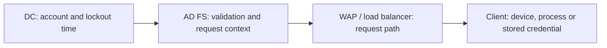

# AD FS Account Lockouts - Correlating AD FS, WAP and Domain Controller Events

**"The account was locked out by the AD FS server" is a starting point, not the name of the guilty device.**

A phone with an old password, a scheduled task and a password-spray attack can all produce repeated failures. When AD FS validates credentials on a client's behalf, the domain controller can see the federation server rather than the original client.

The trick is to follow the request backwards: **directory event, federation request, proxy path, then client evidence**. Do not unlock the account in a loop and hope the source goes away.

## 1. First, which lockout are we investigating?

| Observation | What it establishes | What it does not establish |
|---|---|---|
| DC Security event **4740** | An AD DS account was locked out | The original browser, device or attack source |
| AD FS extranet lockout/account activity | The applicable federation protection is blocking attempts | That the AD DS account is also locked |
| AD FS credential-validation error | Authentication failed at that step | That a bad password, rather than an already locked account, caused it |
| Application sign-in error | The application did not complete the user's sign-in | That AD FS or AD DS locked the account |

Both directory and extranet lockout can exist at the same time. Conversely, extranet protection can stop a request before another bad password reaches AD DS.

For ESL state and configuration, use the [Extranet Smart Lockout guide](../How-to/AD%20FS%20Extranet%20Smart%20Lockout%20-%20Deployment%20and%20Account%20Activity.md). This investigation does not change its thresholds or mode.



*This is the direction of investigation, not the direction of the sign-in traffic.*

## 2. Start at the DC, but do not stop at the caller name

Record the affected account, its SID, the UTC interval and the DC that logged the lockout. Search relevant DCs, including the PDC emulator where appropriate; an empty result from one DC does not clear the whole domain.


*Historical capture from the source notes, cropped and anonymized. Caller Computer Name is an intermediary clue: in a federated path it can name an AD FS node, not the original client.*

The following read-only example runs in **Windows PowerShell 5.1**, with permission to read the DC's Security log and the required remote Event Log connectivity. Replace the example server and UTC times. It limits collection to 15 minutes and refuses truncated results:

```powershell
$dc = 'dc01.corp.example'
$start = [DateTimeOffset]::Parse('2026-10-18T08:00:00Z')
$end = [DateTimeOffset]::Parse('2026-10-18T08:05:00Z')
if ($end -le $start -or ($end - $start).TotalMinutes -gt 15) {
    throw 'Use an increasing interval no longer than 15 minutes.'
}
$limit = 1000
$events = @()
try {
    $events = @(Get-WinEvent -ComputerName $dc -FilterHashtable @{
        LogName = 'Security'
        ProviderName = 'Microsoft-Windows-Security-Auditing'
        Id = 4740
        StartTime = $start.LocalDateTime
        EndTime = $end.LocalDateTime
    } -MaxEvents ($limit + 1) -ErrorAction Stop)
}
catch {
    if ($_.FullyQualifiedErrorId -notlike 'NoMatchingEventsFound*') { throw }
    Write-Warning 'No 4740 found on this DC in this interval; verify audit coverage and retention.'
}
if ($events.Count -gt $limit) {
    throw 'Collection limit reached. Narrow the interval.'
}
foreach ($event in $events) {
    [xml]$xml = $event.ToXml()
    $fields = @{}
    foreach ($field in $xml.SelectNodes(
        '/*[local-name()="Event"]/*[local-name()="EventData"]/*[local-name()="Data"]'
    )) {
        $fields[$field.GetAttribute('Name')] = $field.InnerText
    }
    foreach ($required in 'TargetUserName', 'TargetSid', 'TargetDomainName') {
        if (-not $fields.ContainsKey($required)) {
            throw "Expected 4740 field missing: $required. Inspect the original event XML."
        }
    }
    if ([string]::IsNullOrWhiteSpace($fields['TargetDomainName'])) {
        Write-Warning "Caller name is empty in record $($event.RecordId)."
    }
    [pscustomobject]@{
        TimeUtc = $event.TimeCreated.ToUniversalTime().ToString('o')
        DC = $event.MachineName
        RecordId = $event.RecordId
        Account = $fields['TargetUserName']
        AccountSid = $fields['TargetSid']
        CallerComputerName = $fields['TargetDomainName']
    }
}
```

**Why `TargetDomainName`?** In the standard 4740 XML schema, that field carries the value displayed as **Caller Computer Name**. Do not confuse it with the locked user's AD domain or assume there is a `CallerComputerName` XML element. Verify the source schema if a collector transforms the event.

Keep this output private. Account names, SIDs and machine names belong in the incident record, not a public screenshot.

## 3. Find the matching AD FS request

Collect on **every federation node that could have handled the request**, not just the server named in one event. Check clock alignment, time zones, retention and effective auditing first.

Use the [logging and Activity ID guide](Troubleshooting%20AD%20FS%20-%20Logs,%20Activity%20IDs%20and%20Evidence%20Collection.md) for bounded collection and reversible auditing changes. In particular, AD FS auditing and the effective OS audit policy both matter. Do not enable verbose/debug logging permanently.

| Evidence | How to use it |
|---|---|
| AD FS 2016 audit **1203** | Fresh credential-validation failure; inspect the exception and request context |
| Historical AD FS audit **411** | Bad-credential/failure evidence documented in the lockout troubleshooting guidance; inspect the installed version's payload |
| Historical **516 / 403** pair | Example of connecting a lockout-related event to HTTP request context through an Activity ID |
| AD FS Admin events and ESL activity | Distinguish service failures, extranet blocking and directory rejection |

**An event number without its provider, channel and version is not a reliable search recipe.** The historical 403/516 illustration below is not a promise that a current farm emits those same events.


*The matching sample Activity ID is the useful part. The crop removes the original user, client IP and request body; it illustrates correlation, not a current event-schema contract.*

Start with the account and time window, identify the relevant request, then follow **its** Activity ID. Inspect the structured correlation field or the documented payload field for that version. Do not match an arbitrary GUID in a message, and do not assume DC, AD FS, Entra and application correlation IDs are identical.

Also distinguish **the attempts that caused a lockout** from **later attempts rejected because the account was already locked**. The latter can identify affected clients without identifying the original cause.

## 4. Follow the proxy path to the client

For an external request, establish the actual WAP/load-balancer route. Client-IP information can be forwarded into AD FS audit context; a WAP Admin event is not guaranteed to exist for every sign-in.

| Clue | Useful interpretation | Common trap |
|---|---|---|
| Observed client IP | Candidate network origin or proxy context | NAT/VPN/shared egress is not a unique device |
| User-Agent | Candidate application or client family | It can be shared, absent or forged |
| Request path/protocol and RP | Which authentication flow was used | Not every request reaches the same policy boundary |
| Proxy/backend address | Which hop delivered the request | It may be the load balancer rather than the user |
| Time and Activity ID | A way to join related request evidence | Nearby events can belong to different attempts |

If every failure appears to come from the same load balancer, validate client-IP forwarding through the trusted proxy chain. Do not trust a client-supplied forwarding header merely because it contains a public IP.

If the caller is not an AD FS node, investigate that computer's services, scheduled tasks, mapped connections and credential stores instead. A federation investigation should not absorb an unrelated workstation lockout.

## 5. Fix the source, then prove the result

For a suspected stale credential, confirm the device and process with its owner before updating or removing the stored credential. For suspected attack traffic, involve incident response, check successful sign-ins as well as failures, and use the [password-spray defense note](../Concepts/AD%20FS%20Password%20Spray%20Defense%20-%20Why%20Extranet%20Smart%20Lockout%20Is%20Not%20Enough.md).

After the approved correction:

1. Perform a normal sign-in through the affected path; do not deliberately lock a production account.
2. Check fresh authentication rather than an existing SSO session.
3. Monitor the same evidence sources for at least the known retry cycle of the suspected client.
4. Confirm that both the user experience and the unwanted failures have improved.

An unlock is recovery, not root-cause removal. Record what is **confirmed**, what is only **suspected**, and where telemetry was missing. Never publish raw authentication traces, query strings or unredacted EVTX/XML.

## References

- [Microsoft Learn: Troubleshoot account lockout in AD FS](https://learn.microsoft.com/en-us/troubleshoot/entra/entra-id/mfa/account-lockout-adfs-window-server)
- [Microsoft Learn: Event 4740 and its XML fields](https://learn.microsoft.com/en-us/previous-versions/windows/it-pro/windows-10/security/threat-protection/auditing/event-4740)
- [Microsoft Learn: AD FS events and logging](https://learn.microsoft.com/en-us/windows-server/identity/ad-fs/troubleshooting/ad-fs-tshoot-logging)
- [Microsoft Learn: Extranet Smart Lockout](https://learn.microsoft.com/en-us/windows-server/identity/ad-fs/operations/configure-ad-fs-extranet-smart-lockout-protection)
- [Microsoft Learn: AD FS Risky IP report workbook](https://learn.microsoft.com/en-us/entra/identity/hybrid/connect/how-to-connect-health-adfs-risky-ip-workbook)
