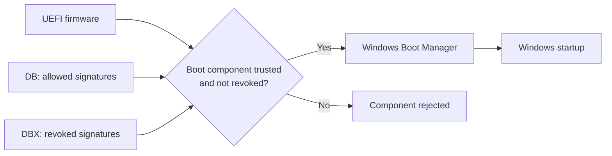

# Secure Boot Certificate Renewal on Windows Server: Audit, Deployment and Validation

Published: 2026-11-04

**Patch Tuesday is green. Your firmware may still be partying like it's 2011.**

Installing Windows updates and updating UEFI trust are separate quests. This guide covers the **2011-to-2023 Secure Boot certificate transition on Windows Server**: inventory, deployment and proof that it worked. No factory-key resets, BIOS-to-UEFI conversions or bonus revocation campaigns.

> **TL;DR**
>
> - Inventory physical servers and UEFI VMs, not just DCs.
> - **Secure Boot enabled**, **Windows patched** and **2023 certificates deployed** are different checkboxes.
> - The 2011 certificates expired in June/October 2026. That alone does **not** brick machines or stop standard Windows updates.
> - Windows Server needs administrator-initiated deployment unless already provisioned. The Windows PC rollout is not your server deployment plan.
> - `UEFICA2023Status` is a **registry value**. Target: `Updated`.
> - **1808** = deployment complete; **1801** = not fully applied; **1800** = restart needed.
> - Missing telemetry means **unknown**, not green. Pilot, prepare recovery, reboot when required, then verify.

## 1. Meet the boot-chain bouncer

UEFI checks boot components before letting them execute. Think **DB = guest list**, **DBX = ban list**. PK and KEK control who can change the trust configuration. This protects startup, not domain authentication.

| Component | Purpose | Important distinction |
|---|---|---|
| Platform Key, or PK | Establishes ownership of the platform's Secure Boot configuration | Not a domain CA or an LDAPS certificate |
| Key Exchange Key database, or KEK | Authorizes updates to the allowed/revoked signature databases | The Microsoft replacement KEK must be appropriately signed for the platform |
| Allowed signature database, or DB | Contains certificates/signatures trusted for boot components | The new Windows boot manager needs the corresponding 2023 trust |
| Forbidden signature database, or DBX | Identifies revoked certificates/signatures | Adding trust and revoking old boot components are different operations |
| Windows Boot Manager | Starts the Windows boot process after firmware validation | Installing a newer boot manager alone does not establish that the firmware trusts it |



These certificates live in **firmware**, including VM virtual firmware. Importing a `.cer` into the Windows certificate store does not update them.

### Expiration is not revocation

**Expired does not mean bricked.** Microsoft says existing devices keep booting and receiving standard Windows updates. What suffers is delivery of new early-boot protections: boot manager, trust-database and revocation updates. "It still boots" is not a certificate audit.

## 2. The 2011-to-2023 upgrade map

From [Microsoft KB5062710](https://aka.ms/GetSecureBoot). **These dates have already passed** as of publication:

| Original certificate | Expiration | Corresponding replacement | Store / role |
|---|---|---|---|
| Microsoft Corporation KEK CA 2011 | June 24, 2026 | Microsoft Corporation KEK 2K CA 2023 | KEK; authorizes DB/DBX updates |
| Microsoft Windows Production PCA 2011 | October 19, 2026 | Windows UEFI CA 2023 | DB; Windows boot loader trust |
| Microsoft UEFI CA 2011 | June 27, 2026 | Microsoft UEFI CA 2023 | DB; third-party boot loader and EFI application trust |
| Microsoft UEFI CA 2011 | June 27, 2026 | Microsoft Option ROM UEFI CA 2023 | DB; third-party option ROM trust |

The third-party CA splits into two roles. Follow the Windows/OEM procedure for the device's existing trust; do not hand-import the same certificate bundle everywhere.

**No firmware spring-cleaning:** do not delete the 2011 certificates, replace the PK or reset keys to factory defaults. Removing required trust is not renewal.

## 3. Scope first, firmware roulette never

| Platform / condition | Treatment |
|---|---|
| Physical server with UEFI and Secure Boot enabled | Assess firmware, Windows servicing support, certificate state and deployment progress |
| UEFI VM with Secure Boot enabled | Assess the guest and its virtual firmware; check the hypervisor vendor's supported VM versions and trust configuration |
| UEFI machine with Secure Boot disabled | Record a separate enablement/hardening gap; do not silently enable it as part of this renewal |
| Legacy BIOS installation or Hyper-V Generation 1 VM | This Secure Boot renewal procedure is not applicable; retain the machine in the inventory with the reason |
| Access denied, unsupported command or unavailable telemetry | Record an unknown/unverified result, not "Secure Boot disabled" or "updated" |
| Azure Local host | Use the dedicated Azure Local servicing guidance rather than this generic server playbook |
| Windows client | Use the Windows client playbook; its rollout assistance and management options differ from Windows Server |

- **Server 2016/2019/2022/2025:** verify the actual build, cumulative updates and platform prerequisites.
- **Server 2012/2012 R2:** separately qualify servicing/ESU eligibility and OEM/hypervisor support. Historical Secure Boot support is not current renewal support.
- **Registry/GPO management:** Microsoft documents availability in updates from **November 11, 2025 for Windows versions still in support**. Check the release-specific updates, not one mythical universal KB.
- **New hardware:** Server 2025-certified platforms may already have the new trust. Installing Server 2025 on old iron does not magically upgrade that iron's certificate store.

### Preparation checklist

- Capture model, firmware, OS/build and physical/virtual status; include hypervisor and VM generation/version.
- Install the appropriate cumulative updates and any required/recommended firmware fixes. Compatible firmware does not need updating just for sport.
- Prepare recovery media, backup/restore and out-of-band access.
- Verify BitLocker recovery-key access where applicable. **No recovery secrets in audit reports.**
- Schedule restarts and preserve workload availability.

Host and golden-image updates are not proof for existing VMs. Check the guests.

## 4. Inventory: look before you poke

### Microsoft already ships a collector

Start with Microsoft's [Sample Secure Boot Inventory Data Collection script](https://support.microsoft.com/topic/d02971d2-d4b5-42c9-b58a-8527f0ffa30b), linked from KB5062713. Save the reviewed sample as **`Detect-SecureBootCertUpdateStatus.ps1`**. No need to reinvent this particular wheel.

It collects Secure Boot state, servicing status/errors, relevant events, OS/hardware/firmware details and deployment-task state. **Monitoring only:** it does not deploy certificates or restart the machine.

Run it on each endpoint through **Configuration Manager, a GPO-deployed scheduled task, or WinRM orchestration**. It is not a central network scanner with automatic fleet discovery.

To write each machine's JSON snapshot to an approved share:

```powershell
.\Detect-SecureBootCertUpdateStatus.ps1 `
    -OutputPath '\\SERVER\SecureBootLogs$'
```

The sample writes **`HOSTNAME_latest.json`**; without `-OutputPath`, it returns JSON on stdout. Review and pilot the sample before broad deployment.

- Protect the share and grant only the required access to the execution identity. On domain-joined endpoints running as SYSTEM, plan for the computer account's network permissions.
- Consolidate snapshots against the expected machine list: missing/stale files are **unknown**, not compliant.
- This is JSON collection, not an all-in-one HTML dashboard. Spend custom scripting effort on orchestration and reporting, not rebuilding the collector.

### Windows clients: the Autopatch dashboard

For **Windows Autopatch-managed client devices**, use the [Secure Boot status report](https://learn.microsoft.com/windows/deployment/windows-autopatch/monitor/secure-boot-status-report).

In the Intune admin center: **Reports > Windows Autopatch > Windows quality updates > Reports > Secure Boot status**.

It shows Secure Boot enablement, certificate currency and applicable missing certificates. It is **not a blanket Windows Server inventory report**. For a mixed estate: server collector, client dashboard where available.

### Local spot-checks

Run these **read-only** examples in elevated Windows PowerShell on a supported, updated server. No certificate changes or reboots. Missing command on an older release? Record the limitation, not a fake green result.

#### Identify the machine and firmware

```powershell
Get-CimInstance -ClassName Win32_OperatingSystem -ErrorAction Stop |
    Select-Object Caption, Version, BuildNumber

Get-CimInstance -ClassName Win32_ComputerSystem -ErrorAction Stop |
    Select-Object Name, Manufacturer, Model

Get-CimInstance -ClassName Win32_BIOS -ErrorAction Stop |
    Select-Object Manufacturer, SMBIOSBIOSVersion, ReleaseDate
```

#### Check whether Secure Boot is enabled

```powershell
Confirm-SecureBootUEFI -ErrorAction Stop
```

| Result | Interpretation |
|---|---|
| `True` | Secure Boot is enabled; this does not establish certificate currency |
| `False` | Secure Boot is disabled on this UEFI platform; handle enablement separately |
| Error | Investigate permissions, platform mode and command support; do not convert the error to `False` |

A status string is not a DB/KEK dump. Retain actual certificate-presence evidence when provisioning history needs qualification.

Keep one row per machine, including unreachable ones:

| Field | Why it matters |
|---|---|
| Computer, role and application owner | Scope, scheduling and accountability |
| OS/build, manufacturer/model and firmware version | Servicing and platform compatibility |
| Physical/virtual, UEFI mode and Secure Boot state | Applicability |
| Certificate-presence evidence and its collection time | Trust may already have been provisioned by the OEM or virtual platform |
| `UEFICA2023Status`, error code and associated event ID | Deployment progress and failure diagnosis |
| Latest relevant events and retained observation window | Events are historical and may have rolled out of the log |
| Read errors, blockers, next action and owner | An unreachable machine must not disappear from the project |

## 5. Registry: state, not a magic switch

`UEFICA2023Status` is a **`REG_SZ` registry value**, not an event. Find it under:

```text
HKEY_LOCAL_MACHINE\SYSTEM\CurrentControlSet\Control\SecureBoot\Servicing
```

| Value | Type | Meaning |
|---|---|---|
| `UEFICA2023Status` | `REG_SZ` | `NotStarted`, `InProgress` or `Updated` |
| `UEFICA2023Error` | `REG_DWORD` | Nonzero means a recorded deployment error; absent/zero does not establish overall completion |
| `UEFICA2023ErrorEvent` | `REG_DWORD` | Associated error event ID when available; correlate with the System log |

| Status | Operational interpretation |
|---|---|
| `NotStarted` | The Windows-managed deployment has not started |
| `InProgress` | In progress; check restart dependencies and errors before intervening |
| `Updated` | New certificates and boot manager successfully deployed |
| Missing or unrecognized | Unverified; check servicing support, OEM provisioning and actual certificates |

### Read-only status example

```powershell
$servicingPath = 'HKLM:\SYSTEM\CurrentControlSet\Control\SecureBoot\Servicing'

if (Test-Path -LiteralPath $servicingPath -ErrorAction Stop) {
    $state = Get-ItemProperty -LiteralPath $servicingPath -ErrorAction Stop
    if ($state.PSObject.Properties.Name -notcontains 'UEFICA2023Status') {
        Write-Warning 'UEFICA2023Status is absent; certificate deployment state is unverified.'
    }
    $state | Select-Object UEFICA2023Status, UEFICA2023Error, UEFICA2023ErrorEvent
}
else {
    Write-Warning 'The Secure Boot servicing key is absent; verify platform support and certificate provisioning.'
}
```

OEM-provisioned trust may have no matching Windows servicing history. Missing status/event does not automatically mean old certificates: verify the actual trust.

### Do not confuse status with deployment controls

The parent key is:

```text
HKEY_LOCAL_MACHINE\SYSTEM\CurrentControlSet\Control\SecureBoot
```

| Value | Purpose | Caution |
|---|---|---|
| `AvailableUpdates` | Bitmask used to request deployment actions | A trigger/progress control, not a compliance status |
| `AvailableUpdatesPolicy` | Policy-managed representation of Secure Boot actions | Microsoft marks this as reference-only: do not edit it directly |
| `MicrosoftUpdateManagedOptIn` | Participation in Microsoft-managed controlled rollout where supported | Not a substitute for the Windows Server deployment procedure |
| `HighConfidenceOptOut` | Controls applicable update-assisted deployment behavior | Do not change rollout controls without understanding their scope |

Writing `Updated` yourself is dashboard cosplay, not remediation.

## 6. Events: read the timeline

Look in **Windows Logs > System**, source **TPM-WMI**. For PowerShell event filtering, the provider name is `Microsoft-Windows-TPM-WMI`.

| Event ID | What it establishes | Next investigation |
|---|---|---|
| **1808** | Required new certificates and 2023-signed boot manager deployed | Corroborate current status and post-change boot |
| **1801** | Certificate/boot-manager update not fully applied | Check targeting, progress, restarts and errors; not proof that Windows patches are missing |
| **1800** | A restart is required before a specified Secure Boot update can proceed | Schedule the restart, then check whether deployment advances |
| **1795** | Firmware returned an error while Windows attempted to update a Secure Boot variable | Capture the error and consult OEM/hypervisor guidance |
| **1802** | Deployment was deliberately blocked for a known hardware/firmware condition | Follow the device-specific remediation; do not bypass the safety block blindly |
| **1803** | A suitable platform-key-signed replacement KEK was not found for the device | Confirm OEM/virtual-platform key provisioning and support |

The word "updated" in **1801** is a trap for speed-readers: update material available is not update applied to firmware.

### Read-only event query

```powershell
$filter = @{
    LogName      = 'System'
    ProviderName = 'Microsoft-Windows-TPM-WMI'
    Id           = 1795, 1800, 1801, 1802, 1803, 1808
    StartTime    = (Get-Date).AddDays(-30)
}

Get-WinEvent -FilterHashtable $filter -ErrorAction Stop |
    Sort-Object TimeCreated -Descending |
    Select-Object TimeCreated, Id, LevelDisplayName, Message
```

This searches **30 days of retained events**, not the machine's autobiography. `NoMatchingEventsFound` is not a clean bill of health. Access/provider errors are separate failures to investigate.

### Read the sequence, not just the presence of an ID

- Old **1801**, then **1808**: deployment may be complete.
- Old **1808**, then restore/reprovisioning/firmware changes: verify current state again.
- No **1808**: could be retention or OEM provisioning, not necessarily failure.
- **1808** with an unfamiliar `BucketConfidenceLevel`: that field describes Microsoft's coverage for similar devices, not a failed deployment here.

Correlate registry, firmware evidence and timestamps. Count machines, not log entries.

## 7. Windows Update brings the package

**Windows updates supply the plumbing and payload. Deployment gets them into firmware.**

On applicable servers not already updated, **administrators must initiate deployment**. The Windows PC Controlled Feature Rollout does not handle this for Windows Server.


The sequence is: applicable **DB certificates**, replacement **KEK**, then the **Windows UEFI CA 2023-signed boot manager**. Each stage depends on the previous one.

The task checks every **12 hours**. The server playbook describes a typical task-cycle delay; enterprise guidance allows around **48 hours and one or more restarts**. Neither is an SLA. Watch progress and errors, not just the clock.

## 8. Deploy: pick one controller

> **Change boundary**
>
> Below this line, commands **change firmware trust and the boot chain**. Approved pilot and maintenance plan required. One controller per device: no GPO/registry tug-of-war.

### Option A: Group Policy

1. Prepare current templates and matching language files: [Windows Server ADMX](https://www.microsoft.com/download/details.aspx?id=108430).
2. Back up/stage the Central Store. Do not blindly merge competing ADMX/ADML packages; templates do not add endpoint servicing support.
3. Target a pilot GPO at approved computer accounts.
4. Navigate to:

   ```text
   Computer Configuration
     > Administrative Templates
       > Windows Components
         > Secure Boot
   ```

5. Set **Enable Secure Boot Certificate Deployment** to **Enabled**.
6. Confirm effective policy, allow servicing, schedule required restarts.
7. Verify success before expanding.

Target computers, not just the DC OU. Member servers and guests need coverage too.

Use this specific setting from [KB5068198](https://support.microsoft.com/kb/5068198), not every Secure Boot policy. Deployment, automatic-update assistance and controlled rollout are different switches.

### Option B: documented registry deployment

Set **`AvailableUpdates = 0x5944`** (`REG_DWORD`) under the parent Secure Boot key to request the applicable certificates and 2023-signed boot manager.

First check for existing policies/controllers and in-progress deployment. Repeatedly overwriting a moving bitmask is not a progress accelerator.

**State-changing example, for an approved local pilot only:**

```powershell
if (-not (Confirm-SecureBootUEFI -ErrorAction Stop)) {
    throw 'Secure Boot is disabled. Qualify enablement separately before this deployment.'
}

$null = Get-ScheduledTask -TaskPath '\Microsoft\Windows\PI\' `
    -TaskName 'Secure-Boot-Update' -ErrorAction Stop

New-ItemProperty -LiteralPath 'HKLM:\SYSTEM\CurrentControlSet\Control\SecureBoot' `
    -Name 'AvailableUpdates' -PropertyType DWord -Value 0x5944 `
    -Force -ErrorAction Stop | Out-Null
```

This **starts**, not completes, deployment. It does not reboot or replace the OS, firmware and recovery prerequisites.

To skip the normal task delay **in a lab pilot**:

```powershell
Start-ScheduledTask -TaskPath '\Microsoft\Windows\PI\' `
    -TaskName 'Secure-Boot-Update' -ErrorAction Stop
```

This **performs deployment**, not audit. Restart in the agreed window if required, then recheck. No surprise-reboot command included.

`AvailableUpdates` clears action bits but may retain control bits: **zero is not the only success test**. Never edit `AvailableUpdatesPolicy` directly.

### Other platform-specific methods

WinCS has specific OS, domain-join, update and tool requirements; check the server playbook first. Client Intune/Autopatch instructions are not a universal server recipe.

## 9. Targeted != updated

A green GPO is not a firmware health bar. Close a Windows-managed deployment only after:

- **Completion evidence:** `Updated`, relevant event 1808 and no newer unresolved error.
- **Boot/workload checks:** the planned restart succeeded and the workload still works.
- **Recovery checks:** validate applicable backup restore, recovery media, PXE/WinPE and third-party boot components.

For OEM-preprovisioned systems without Windows servicing history, keep platform-specific certificate/boot-chain evidence instead of inventing a missing event.

Expiration alone does not invalidate old media; trust changes and separate revocation enforcement can. A normal reboot does not test your entire recovery toolbox.

## 10. Troubleshoot, don't exorcise

| Observation | Interpretation / next step |
|---|---|
| Status absent | Verify OS servicing support and OEM provisioning; inspect actual certificate evidence |
| `InProgress` with event 1800 | Honor the restart dependency and recheck after the planned restart |
| `InProgress` with nonzero `UEFICA2023Error` | Correlate `UEFICA2023ErrorEvent` and the System event details |
| Event 1795 | Investigate the firmware error and applicable OEM/hypervisor fixes |
| Event 1802 | Follow the published compatibility-block remediation |
| Event 1803, possibly with `AvailableUpdates = 0x4104` | The KEK stage may be blocked by missing platform-key-signed material; contact the OEM/virtual-platform provider |
| Windows patches installed, but no deployment progress | Confirm the selected server deployment method, effective targeting, task availability and prerequisites |
| Old 1801 followed by 1808 and current `Updated` | Do not keep reporting the historical error as an unresolved failure without newer contrary evidence |

No status edits, Secure Boot disabling, trust deletion or factory-key resets to make an error disappear. Fix the cause, not the dashboard.

### Rollback: no universal Ctrl+Z

Removing the deployment setting **does not undo firmware changes**. The GPO can also leave its registry value behind when removed.

Prepare platform-supported recovery before the pilot. An OS uninstall, VM checkpoint or disabled GPO is not a guaranteed rewind of firmware and boot-chain state.

## 11. Rollout: waves, not YOLO

1. **Inventory:** every machine, including unknown/non-applicable results.
2. **Group:** model/firmware, hypervisor/VM generation, OS build and boot dependencies.
3. **Pilot:** representative platforms, less impactful workloads.
4. **Validate:** certificates, restart, workloads and recovery.
5. **Expand:** validated families, named owners, explicit stop criteria.
6. **Reconcile:** blocked/unreachable/unsupported systems stay visible until fixed, replaced or formally excepted.

Preserve healthy capacity for DCs, clusters and HA services. Rebooting every member together is an outage plan, not a rollout plan.

**Success is evidence per machine, not a GPMC screenshot.** Track renewal, Secure Boot enablement, OS support and revocation as separate work items.

## Related reading

- [Windows Client Security Power-Ups - The Quick Wins That Actually Matter](../../../040%20-%20Endpoint%20Security/OS%20Hardening/Windows%20Client%20Security%20Power-Ups%20-%20The%20Quick%20Wins%20That%20Actually%20Matter.md): client-side Secure Boot/TPM health and related platform controls.
- [Securing the Hyper-V Fabric Hosting Domain Controllers and Tier 0 Assets](../../../060%20-%20Active%20Directory/Concepts/Securing%20the%20Hyper-V%20Fabric%20Hosting%20Domain%20Controllers%20and%20Tier%200%20Assets.md): the virtualization platform as part of the trust boundary.

## References

- [Windows Server Secure Boot playbook for certificates expiring in 2026](https://aka.ms/SecureBootForServer)
- [Prepare your servers for Secure Boot certificate updates](https://www.microsoft.com/en-us/windows-server/blog/2026/02/23/prepare-your-servers-for-secure-boot-certificate-updates/)
- [Windows Secure Boot certificate expiration and CA updates - KB5062710](https://aka.ms/GetSecureBoot)
- [Secure Boot certificate updates: guidance for IT professionals and organizations - KB5062713](https://support.microsoft.com/kb/5062713)
- [Sample Secure Boot Inventory Data Collection script](https://support.microsoft.com/topic/d02971d2-d4b5-42c9-b58a-8527f0ffa30b)
- [Secure Boot status report in Windows Autopatch](https://learn.microsoft.com/windows/deployment/windows-autopatch/monitor/secure-boot-status-report)
- [Registry key updates for IT-managed devices - KB5068202](https://support.microsoft.com/kb/5068202)
- [Group Policy deployment method - KB5068198](https://support.microsoft.com/kb/5068198)
- [Secure Boot DB and DBX variable update events - KB5016061](https://support.microsoft.com/kb/5016061)
- [OEM pages for Secure Boot](https://support.microsoft.com/topic/original-equipment-manufacturer-oem-pages-for-secure-boot-9ecc3ba4-fb50-4bd3-9e9b-f16b35b8fb68)
- [Create and manage the Group Policy Central Store](https://learn.microsoft.com/troubleshoot/windows-client/group-policy/create-and-manage-central-store)
- [Windows Server Administrative Templates](https://www.microsoft.com/download/details.aspx?id=108430)
- [Windows client Secure Boot playbook](https://aka.ms/SecureBootPlaybook)
- [Azure Local Secure Boot certificate servicing](https://learn.microsoft.com/azure/azure-local/security-update/security-update#windows-secure-boot-certificate-expiration)
