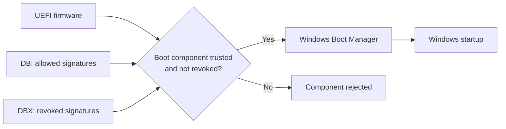

# Secure Boot Certificate Renewal on Windows Server: Audit, Deployment and Validation

Published: 2026-11-04

**Secure Boot is enabled. Great. Its certificates may still be from 2011.**

This guide explains what to check, which GPO to use on Windows Server, and how to tell whether the update worked.

**The practical route:** [check the machines](#3-check-the-current-state), [deploy to a small pilot](#4-deploy-to-a-small-pilot), then [confirm the result](#5-confirm-that-it-worked). The certificate names and firmware internals are in the optional reference at the end.

## 1. What are we updating?

Secure Boot checks that the software used to start the machine comes from a trusted publisher. It uses certificates stored in **UEFI firmware**, the software that starts the machine before Windows.

Microsoft is replacing its **2011-generation certificates with 2023-generation certificates**, together with a Windows Boot Manager signed by the new certificate. Windows Boot Manager is the program that starts Windows.

**2023 is a certificate generation, not a Windows Server version.**

| Question | Short answer |
|---|---|
| Secure Boot is enabled. Am I done? | No. Enabled does not mean the certificates are updated |
| Windows is patched. Am I done? | Not necessarily. Updates supply the required files; deployment applies them to firmware |
| Will certificate expiration alone stop booting? | No. Microsoft says existing machines keep booting and receiving standard Windows updates |
| Why update, then? | Without the new trust, machines may miss new boot-manager, trust-database and revocation protections |
| Does Windows Server deploy this automatically like PCs? | No. Administrators must initiate deployment unless the machine is already provisioned |

The old certificates expired in **June/October 2026**, before this article's publication. This is a protection update, not a reason to panic-reset firmware keys.

**Do not disable Secure Boot, delete old certificates or import a `.cer` into the Windows certificate store to fix this.** Windows certificate stores and UEFI trust are different places.

## 2. Which machines need checking?

| Platform / condition | Treatment |
|---|---|
| Physical server with UEFI and Secure Boot enabled | Check its certificate state and update support |
| UEFI VM with Secure Boot enabled | Check the guest and its virtual firmware/hypervisor support |
| Secure Boot disabled | Record it separately; this guide does not silently enable it |
| Legacy BIOS or Hyper-V Generation 1 VM | Not applicable to this procedure; keep the reason in the inventory |
| Read error or unsupported command | Unknown, not "disabled" or "updated" |
| Azure Local host | Use the dedicated Azure Local guidance |
| Windows client | Use the client deployment guidance, not the server rollout unchanged |

For **Server 2016/2019/2022/2025**, check the actual build, updates and platform support. For **2012/2012 R2**, also qualify servicing/ESU eligibility and vendor support.

The registry/GPO deployment support is documented in updates from **November 11, 2025 for versions still in support**. Check the requirements for your release, not just the OS name.

Server 2025-certified hardware may already contain the new certificates. Installing Server 2025 on older hardware does not update firmware trust by itself. Likewise, updating a host or golden image does not prove that existing guests are updated.

## 3. Check the current state

**Start with an inventory, not a deployment GPO.** These checks do not change firmware or restart machines.

### A. For a fleet: choose a collector

**Our remote version:** [Invoke-SecureBootAudit.ps1](./Invoke-SecureBootAudit.ps1) uses the inventory checks described by Microsoft, adds **WinRM collection from a CSV**, and generates **HTML, CSV and JSON**. It is an independent community implementation, not a Microsoft-supported tool.

Edit [Computers.example.csv](./Computers.example.csv), using UTF-8 and **semicolons**:

```csv
ComputerName;Description
server01.example.test;Physical server pilot
server02.example.test;Virtual machine pilot
```

From this directory, in **PowerShell 7.2+ on Windows**:

```powershell
.\Invoke-SecureBootAudit.ps1 -CsvPath .\Computers.example.csv -OpenReport
```

Every listed target uses **existing WinRM**; remote code supports Windows PowerShell **5.1**. The account needs endpoint access and permission to read Secure Boot, registry, CIM, System events and task state; Domain Admin is not required. No RSAT, AD discovery or Internet download is needed.

Open **`SecureBootAudit.html`**. Start with collection errors, then Windows status and latest events. Unreachable machines remain visible; collection continues on the others.

**`UpdatedReported` means Windows evidence agrees, not "firmware certified".** Still validate boot, applications and recovery. Missing data stays unknown.

<details>
<summary>Our collector: parameters, outputs and interpretation</summary>

| Parameter | Meaning |
|---|---|
| `CsvPath` | Required semicolon CSV; `ComputerName` required, `Description` optional; extra columns ignored |
| `Credential` | Optional `Get-Credential` identity, never written to reports |
| `UseSSL` | Existing WinRM HTTPS listener, TCP **5986**, with normal certificate validation |
| `TimeoutSeconds` | Per-machine deadline including connection and collection; default **120**, range 1-3600 |
| `MaxEvents` | Newest matching retained events per machine; default **50**, range 1-10000 |
| `OutputDir` | New local output folder; default unique folder under `Outputs`; existing folders rejected |
| `OpenReport` | Open HTML after saving all files, including partial reports |

Default transport is WinRM HTTP **TCP 5985**, with normal authentication/message encryption. DNS/Kerberos connectivity is also needed in a domain. Use FQDNs; do not weaken WinRM with TrustedHosts/AllowUnencrypted or certificate bypasses. Event/CIM reads run **inside WinRM**, not direct Event Log RPC/DCOM from the reporting computer. `localhost` also uses WinRM.

Blank/invalid/duplicate computer names are rejected **before any connection**. Targets are processed sequentially; the timeout applies per computer, not to the whole CSV. Job cancellation/cleanup can take a few additional seconds.

The inventory includes Secure Boot state/source, Windows deployment status/errors, deployment registry controls, OS/build/architecture/last boot, model/firmware/baseboard, device attributes, task state and System events. WinCS is queried only if its tool is installed; raw output/exit code are kept, without guessing "Applied" from localized text.

**Events are not a 24-hour query.** The collector reads up to `MaxEvents` of the newest matching **System / Microsoft-Windows-TPM-WMI** records: **1795, 1796, 1800-1803, 1808**. An extra record detects truncation. Counts describe only collected records; older history may be unavailable. Named XML fields and raw XML are retained.

| File | Contents |
|---|---|
| `SecureBootAudit.html` | Self-contained, searchable offline report; expandable per-machine evidence and notes |
| `Computers.csv` | One row per requested machine, including failures, status and inventory |
| `Events.csv` | Collected events, UTC timestamps, named fields and raw XML |
| `Issues.csv` | Collection errors, missing data, fallbacks and event-limit notices |
| `SecureBootAudit.json` | Complete run/transport metadata, targets, inventory, events and issues |

All CSV exports use **`;`**, UTF-8 BOM and spreadsheet-formula protection; JSON preserves original values. Keep exports beside the HTML. Reports contain infrastructure identifiers: use controlled storage. Generated `Outputs` are ignored by Git.

| Assessment | Interpretation |
|---|---|
| `UpdatedReported` | Secure Boot enabled, Windows `Updated`, latest collected event **1808**, no collection errors/nonzero servicing error; still not attestation |
| `ReviewRequired` | Servicing error, latest failure/block, or `Updated` without matching completion evidence |
| `RestartIndicated` | Latest relevant event **1800**; arrange an approved restart, then recheck |
| `InProgress` / `NotStarted` | Windows deployment state, not completion |
| `Disabled` | Secure Boot disabled; enablement is a separate change |
| `Unknown` / `CollectionFailed` | Missing/unreadable/unsupported evidence or failed/timed-out remote collection |

Old 1801 followed by newer 1808 does not automatically remain a failure. Conversely, an older 1808 does not hide a newer firmware error. Vendor-preprovisioned systems without Windows history require separate certificate/boot-chain evidence. This collector does **not** enumerate or attest the entire PK/KEK/DB/DBX trust store.

**Exit codes concern collection, not certificate compliance:** target/read errors save partial reports and exit **1**; findings, missing history or a deployment still pending can exit **0** without being updated. Invalid input, report-write and report-open failures remain terminating errors. Dot-sourced `Invoke-SecureBootAuditRun` callers inspect `ErrorCount` and `Status`.

[Collector tests](./Tests/Invoke-SecureBootAudit.Tests.ps1) use synthetic XML and mocked Windows/WinRM reads; no production targets. They cover CSV scope, deadlines, failures, event ordering, evidence interpretation and safe exports.

</details>

<details>
<summary>Microsoft's endpoint inventory sample remains an option</summary>

Microsoft's [Sample Secure Boot Inventory Data Collection script](https://support.microsoft.com/topic/d02971d2-d4b5-42c9-b58a-8527f0ffa30b) is the original reference for these checks.

**Microsoft marks that page as retired.** With updates released on/after **May 12, 2026**, examples are supplied under **`%systemroot%\SecureBoot\ExampleRolloutScripts`**. Review the detection/inventory example and its help; not every rollout script is read-only.

The published sample, named **`Detect-SecureBootCertUpdateStatus.ps1`**, collects status/errors, events, hardware/firmware/OS and servicing-task details. It **does not deploy certificates** or discover machines.

Run the reviewed detection sample **on each endpoint**, through Configuration Manager, a GPO-deployed scheduled task or existing orchestration. Its published share-output example is:

```powershell
.\Detect-SecureBootCertUpdateStatus.ps1 `
    -OutputPath '\\SERVER\SecureBootLogs$'
```

`-OutputPath` is a **folder**. The sample writes **`HOSTNAME_latest.json`** there; without it, JSON goes to stdout.

Protect the share and grant only necessary permissions. On domain-joined endpoints running as SYSTEM, account for the computer account's network access.

Compare the JSON files with the expected machine list. Missing/stale results mean **unknown**, not updated. Unlike our remote version, this is endpoint JSON collection, not a ready-made fleet dashboard.

</details>

<details>
<summary>Windows clients: an Autopatch report is also available</summary>

For **Windows Autopatch-managed client devices**, use the [Secure Boot status report](https://learn.microsoft.com/windows/deployment/windows-autopatch/monitor/secure-boot-status-report).

In the Intune admin center: **Reports > Windows Autopatch > Windows quality updates > Reports > Secure Boot status**.

It shows Secure Boot enablement, certificate status and applicable missing certificates. It is **not an inventory report for all Windows servers**.

</details>

### B. On one server: is Secure Boot enabled?

Run the local checks in **elevated Windows PowerShell** on a supported, updated server:

```powershell
Confirm-SecureBootUEFI -ErrorAction Stop
```

| Result | Interpretation |
|---|---|
| `True` | Enabled. Continue with the certificate checks |
| `False` | Disabled. Treat enablement as a separate change |
| Error | Check permissions, UEFI mode and command support. Do not report `False` or success |

### C. Has Windows completed the certificate deployment?

Read **`UEFICA2023Status`**: a **`REG_SZ` registry value**, not an event or a certificate. It records Windows deployment progress under:

```text
HKEY_LOCAL_MACHINE\SYSTEM\CurrentControlSet\Control\SecureBoot\Servicing
```

| Status | What to do |
|---|---|
| `NotStarted` | Deployment has not started. Check prerequisites and targeting |
| `InProgress` | Not finished. Check whether a restart or error needs attention |
| `Updated` | Windows reports the new certificates and boot manager deployed. Validate boot and workloads |
| Missing or unrecognized | Unknown. Check update support and whether the vendor already provisioned certificates |

```powershell
$servicingPath = 'HKLM:\SYSTEM\CurrentControlSet\Control\SecureBoot\Servicing'

if (Test-Path -LiteralPath $servicingPath -ErrorAction Stop) {
    $state = Get-ItemProperty -LiteralPath $servicingPath -ErrorAction Stop
    if ($state.PSObject.Properties.Name -notcontains 'UEFICA2023Status') {
        Write-Warning 'UEFICA2023Status is absent; certificate deployment state is unverified.'
    }
    $state | Select-Object UEFICA2023Status, UEFICA2023Error, UEFICA2023ErrorEvent
}
else {
    Write-Warning 'The Secure Boot servicing key is absent; verify platform support and certificate provisioning.'
}
```

The two `REG_DWORD` error values help diagnose failures: **`UEFICA2023Error`** is the error code; **`UEFICA2023ErrorEvent`** identifies the associated event. Zero/absent errors alone do not prove completion.

Some vendors preinstall the certificates without Windows deployment history. Missing status does not automatically mean old certificates: keep actual certificate/boot-chain evidence. **Never write `Updated` yourself.**

### D. What do the events say?

Look in **Windows Logs > System**, source **TPM-WMI**. For PowerShell event filtering, the provider name is `Microsoft-Windows-TPM-WMI`.

| Event ID | Meaning | Next action |
|---|---|---|
| **1808** | Deployment completed | Confirm current status, boot and workloads |
| **1801** | Update not fully applied | Check progress, targeting, restarts and errors |
| **1800** | Restart needed before an update stage can continue | Schedule it, then recheck progress |

**1801 is not a success event**, and it does not by itself mean Windows patches are missing. Firmware errors **1795/1802/1803** are covered in troubleshooting.

```powershell
$filter = @{
    LogName      = 'System'
    ProviderName = 'Microsoft-Windows-TPM-WMI'
    Id           = 1795, 1800, 1801, 1802, 1803, 1808
    StartTime    = (Get-Date).AddDays(-30)
}

Get-WinEvent -FilterHashtable $filter -ErrorAction Stop |
    Sort-Object TimeCreated -Descending |
    Select-Object TimeCreated, Id, LevelDisplayName, Message
```

This searches **30 days of retained events**, not the machine's whole history. No matching events is not proof of success; access/provider errors must be investigated.

<details>
<summary>Optional local check: record the OS, model and firmware</summary>

```powershell
Get-CimInstance -ClassName Win32_OperatingSystem -ErrorAction Stop |
    Select-Object Caption, Version, BuildNumber

Get-CimInstance -ClassName Win32_ComputerSystem -ErrorAction Stop |
    Select-Object Name, Manufacturer, Model

Get-CimInstance -ClassName Win32_BIOS -ErrorAction Stop |
    Select-Object Manufacturer, SMBIOSBIOSVersion, ReleaseDate
```

</details>

Keep one row per expected machine: name/role/owner, OS/build/model/firmware, physical/VM and Secure Boot state, certificate evidence/date, deployment status/errors, log-history coverage, blocker and next action. Unreachable machines stay in the list as **unknown**.

## 4. Deploy to a small pilot

**Recommended server path: use the GPO `Enable Secure Boot Certificate Deployment`, set to `Enabled`.** Do not enable all three Secure Boot policies.

Windows updates provide the files. The GPO requests deployment. The scheduled task **`\Microsoft\Windows\PI\Secure-Boot-Update`** applies the update to firmware and the boot manager. Restarts may be required.


### Before enabling deployment

- Choose representative hardware/firmware or virtual-platform families.
- Install required Windows updates and any required/recommended vendor firmware fixes. Not every compatible device needs a firmware update.
- Prepare backup/restore, working recovery media and out-of-band access.
- Verify BitLocker recovery-key access where applicable; **never collect recovery secrets in the report**.
- Plan restarts and preserve service availability.

> **Change boundary:** deployment settings/examples in this section can change firmware trust and the boot chain. Use **one deployment method per machine**, with an approved pilot and maintenance plan.

### Recommended: Group Policy

1. Prepare [Windows Server ADMX](https://www.microsoft.com/download/details.aspx?id=108430) and matching language files, published **October 27, 2025 or later** per Microsoft. This package can manage supported older servers too; check section 2.
2. Back up/stage the Central Store. Do not blindly merge competing ADMX/ADML packages; templates do not add endpoint servicing support.
3. Link the pilot GPO to the intended computer OU; use security filtering to restrict it to a pilot computer group if needed. Include a representative of each hardware/firmware or virtual-platform family.
4. Navigate to:

   ```text
   Computer Configuration
     > Administrative Templates
       > Windows Components
         > Secure Boot
   ```

5. Set **Enable Secure Boot Certificate Deployment** to **Enabled**.
6. Confirm the winning **computer** settings with Group Policy Results or `gpresult.exe /scope computer /h .\SecureBoot-GPResult.html` (writes a local policy report). A linked GPO is not proof that the target applied it.
7. Allow servicing, schedule required restarts, then confirm the result using section 5.

Target computers, not just the DC OU. Member servers and guests need coverage too.

**Do not expect an instant update.** Group Policy refresh delivers the request; the servicing task normally checks every **12 hours**. Guidance allows around **48 hours and one or more restarts**, not a guaranteed deadline. Watch progress and errors.

Setting this deployment policy to Disabled/Not Configured does not request automatic deployment through it. **It does not undo firmware changes.** Removing the GPO can leave its registry value behind.

> **The naming trap:** **Automatic Certificate Deployment via Updates = Enabled blocks automatic assistance.** It is not the deployment GPO above. Do not enable it just because its name sounds helpful.

<details>
<summary>Optional: understand all three Secure Boot policies</summary>

[Microsoft KB5068198](https://support.microsoft.com/kb/5068198) describes one direct deployment request and two Microsoft-assisted rollout controls:

| Policy | Enabled | Disabled | Not Configured |
|---|---|---|---|
| **Enable Secure Boot Certificate Deployment** | Request deployment when the servicing task runs | No automatic deployment requested through this setting | Same default: no request through this setting |
| **Automatic Certificate Deployment via Updates** | **Block** the validated/high-confidence automatic update path | Allow automatic deployment on validated devices | Automatic deployment by default where applicable |
| **Certificate Deployment via Controlled Feature Rollout** | Opt into Microsoft-managed CFR; requires sending required Windows diagnostic data | No CFR participation | No CFR participation |

Registry counterparts: **`AvailableUpdates`**, **`HighConfidenceOptOut`**, **`MicrosoftUpdateManagedOptIn`**, respectively.

For the second policy, Enabled means `HighConfidenceOptOut = 1` (**opt out**); Disabled means `0` (**opt in**). "High confidence" refers to configurations validated for successful updates.

The other two policies are **not prerequisites for the server pilot**. Review existing settings rather than overriding them blindly. Windows Server does not receive the Windows PC automatic CFR rollout.

Not Configured is not a universal Off switch: the defaults differ. `AvailableUpdatesPolicy` reflects managed policy intent; **never edit it directly**.

</details>

<details>
<summary>Alternative: use the registry instead of Group Policy</summary>

Set **`AvailableUpdates = 0x5944`** (`REG_DWORD`) under the parent Secure Boot key to request the applicable certificates and 2023-signed boot manager.

First check for existing deployment policies and in-progress work. Do not use this alongside a GPO or repeatedly overwrite the value while Windows updates it.

**State-changing example, for an approved local pilot only:**

```powershell
if (-not (Confirm-SecureBootUEFI -ErrorAction Stop)) {
    throw 'Secure Boot is disabled. Qualify enablement separately before this deployment.'
}

$null = Get-ScheduledTask -TaskPath '\Microsoft\Windows\PI\' `
    -TaskName 'Secure-Boot-Update' -ErrorAction Stop

New-ItemProperty -LiteralPath 'HKLM:\SYSTEM\CurrentControlSet\Control\SecureBoot' `
    -Name 'AvailableUpdates' -PropertyType DWord -Value 0x5944 `
    -Force -ErrorAction Stop | Out-Null
```

This **starts**, not completes, deployment. It does not reboot or replace the OS, firmware and recovery prerequisites.

To skip the normal task delay **in a lab pilot**:

```powershell
Start-ScheduledTask -TaskPath '\Microsoft\Windows\PI\' `
    -TaskName 'Secure-Boot-Update' -ErrorAction Stop
```

This **performs deployment**, not audit. Restart in the agreed window if required, then recheck. No surprise-reboot command included.

`AvailableUpdates` clears action bits but may retain control bits: **zero is not the only success test**. Never edit `AvailableUpdatesPolicy` directly.

</details>

Other methods such as WinCS have specific OS, domain-join, update and tool requirements: follow the server playbook. Client Intune/Autopatch instructions are not a universal server procedure.

## 5. Confirm that it worked

A GPO applied successfully? Good. Now check the machine, not just the policy.

| Check | Expected result |
|---|---|
| Windows deployment status | `UEFICA2023Status = Updated` |
| Completion event | Relevant **1808**, with no newer unresolved error |
| Restart and applications | Machine boots and workloads still work |
| Recovery paths | Applicable restore, recovery media, PXE/WinPE and third-party boot components work |

These are the normal checks for a **Windows-managed deployment**. If status or event history is missing, investigate log retention and vendor provisioning. Keep the result **unknown** until actual certificate/boot-chain evidence establishes it.

A normal restart does not test recovery media. Expiration alone does not invalidate old media, but trust changes and separate revocation enforcement can.

<details>
<summary>If the events look contradictory: read their order</summary>

- Old **1801**, then **1808** and current `Updated`: the earlier issue may be resolved.
- Old **1808**, then restore, reprovisioning or firmware changes: check current state again.
- No **1808**: retention or vendor provisioning may explain it; missing history does not prove failure or success.
- `BucketConfidenceLevel` describes Microsoft's coverage for similar configurations. It does not turn a successful 1808 into a failure.

Use registry status, firmware evidence and timestamps together. Count machines, not log entries.

</details>

## 6. If something is blocked

| Observation | Interpretation / next step |
|---|---|
| Status absent | Check update support and vendor provisioning; keep the result unknown until verified |
| `InProgress` + **1800** | Restart in the agreed window, then recheck |
| `InProgress` + nonzero error | Read `UEFICA2023ErrorEvent` and the matching System event |
| **1795** | Firmware returned an error; check OEM/hypervisor fixes |
| **1802** | A known compatibility condition blocked deployment; follow its remediation, do not bypass it |
| **1803**, possibly `AvailableUpdates = 0x4104` | A correctly signed firmware key update (replacement KEK) is missing; contact the OEM/virtual-platform provider |
| Patched, but nothing starts | Check effective GPO/request, servicing-task availability and prerequisites |
| Old 1801, newer 1808 + `Updated` | Do not treat the old event as an unresolved failure without newer evidence |

Do not edit status, disable Secure Boot, delete trust or reset firmware keys to make an error disappear.

**Rollback is not "unlink the GPO".** Applied firmware changes stay applied; the deployment registry value can also remain. Prepare platform-supported recovery before the pilot. An OS uninstall or VM checkpoint is not a guaranteed firmware/boot-chain rollback.

## 7. Roll out in waves

1. **Inventory:** every machine, including unknown/non-applicable results.
2. **Group similar configurations:** model/firmware, hypervisor/VM generation, OS build and boot dependencies.
3. **Pilot:** representative machines with less impactful workloads.
4. **Validate:** certificates, restart, applications and recovery.
5. **Expand:** only validated groups, with owners and stop criteria.
6. **Follow up:** keep blocked/unreachable/unsupported machines visible until fixed, replaced or formally excepted.

Microsoft recommends using **device bucket IDs/hashes**, where available, to help group similar configurations after a representative test. These identifiers do not target a GPO by themselves or prove every machine is updated.

Preserve healthy capacity for DCs, clusters and HA services. Rebooting every member together is an outage plan, not a rollout plan.

**Success is evidence per machine, not a GPMC screenshot.** Track renewal, Secure Boot enablement, OS support and revocation as separate work items.

## Reference: firmware and registry details

<details>
<summary>Optional: certificate names, dates and firmware stores</summary>

UEFI keeps certificates/signatures in firmware, including VM virtual firmware. This is separate from the Windows certificate store.

| Component | Purpose | Important distinction |
|---|---|---|
| Platform Key, or PK | Establishes ownership of the platform's Secure Boot configuration | Not a domain CA or an LDAPS certificate |
| Key Exchange Key database, or KEK | Authorizes updates to the allowed/revoked signature databases | The Microsoft replacement KEK must be appropriately signed for the platform |
| Allowed signature database, or DB | Contains certificates/signatures trusted for boot components | The new Windows boot manager needs the corresponding 2023 trust |
| Forbidden signature database, or DBX | Identifies revoked certificates/signatures | Adding trust and revoking old boot components are different operations |
| Windows Boot Manager | Starts the Windows boot process after firmware validation | Installing a newer boot manager alone does not establish that the firmware trusts it |



From [Microsoft KB5062710](https://aka.ms/GetSecureBoot); these dates have passed as of publication:

| Original certificate | Expiration | Corresponding replacement | Store / role |
|---|---|---|---|
| Microsoft Corporation KEK CA 2011 | June 24, 2026 | Microsoft Corporation KEK 2K CA 2023 | KEK; authorizes DB/DBX updates |
| Microsoft Windows Production PCA 2011 | October 19, 2026 | Windows UEFI CA 2023 | DB; Windows boot loader trust |
| Microsoft UEFI CA 2011 | June 27, 2026 | Microsoft UEFI CA 2023 | DB; third-party boot loader and EFI application trust |
| Microsoft UEFI CA 2011 | June 27, 2026 | Microsoft Option ROM UEFI CA 2023 | DB; third-party option ROM trust |

The third-party CA splits into two roles. Follow the device's Windows/OEM procedure, not a hand-imported universal bundle.

Deployment applies the applicable **DB certificates**, replacement **KEK**, then the **Windows UEFI CA 2023-signed boot manager**. Each stage depends on the previous one.

Do not delete the 2011 certificates, replace the PK or reset keys to factory defaults as renewal.

</details>

<details>
<summary>Optional: deployment registry values</summary>

These are **controls**, not completion status. They live under:

```text
HKEY_LOCAL_MACHINE\SYSTEM\CurrentControlSet\Control\SecureBoot
```

| Value | Role | Caution |
|---|---|---|
| `AvailableUpdates` | Request deployment actions and track their processing | Not a compliance status; do not keep overwriting it |
| `AvailableUpdatesPolicy` | Reflect managed policy intent | Reference-only; never edit it directly |
| `MicrosoftUpdateManagedOptIn` | Opt into Microsoft-managed CFR where supported | Requires sending required diagnostic data; not the server deployment method |
| `HighConfidenceOptOut` | Opt out of automatic deployment to validated configurations | `1` opts out; `0`/absent allows it where applicable; corresponding GPO Enabled means opt-out |

The separate `Servicing` subkey contains the deployment status/error values read in section 3.

</details>

## Related reading

- [Windows Client Security Power-Ups - The Quick Wins That Actually Matter](../../../../040%20-%20Endpoint%20Security/OS%20Hardening/Windows%20Client%20Security%20Power-Ups%20-%20The%20Quick%20Wins%20That%20Actually%20Matter.md): client-side Secure Boot/TPM health and related platform controls.
- [Securing the Hyper-V Fabric Hosting Domain Controllers and Tier 0 Assets](../../../../060%20-%20Active%20Directory/Concepts/Securing%20the%20Hyper-V%20Fabric%20Hosting%20Domain%20Controllers%20and%20Tier%200%20Assets.md): the virtualization platform as part of the trust boundary.

## References

- [Windows Server Secure Boot playbook for certificates expiring in 2026](https://aka.ms/SecureBootForServer)
- [Prepare your servers for Secure Boot certificate updates](https://www.microsoft.com/en-us/windows-server/blog/2026/02/23/prepare-your-servers-for-secure-boot-certificate-updates/)
- [Windows Secure Boot certificate expiration and CA updates - KB5062710](https://aka.ms/GetSecureBoot)
- [Secure Boot certificate updates: guidance for IT professionals and organizations - KB5062713](https://support.microsoft.com/kb/5062713)
- [Sample Secure Boot Inventory Data Collection script](https://support.microsoft.com/topic/d02971d2-d4b5-42c9-b58a-8527f0ffa30b)
- [Secure Boot status report in Windows Autopatch](https://learn.microsoft.com/windows/deployment/windows-autopatch/monitor/secure-boot-status-report)
- [Registry key updates for IT-managed devices - KB5068202](https://support.microsoft.com/kb/5068202)
- [Group Policy deployment method - KB5068198](https://support.microsoft.com/kb/5068198)
- [Secure Boot DB and DBX variable update events - KB5016061](https://support.microsoft.com/kb/5016061)
- [OEM pages for Secure Boot](https://support.microsoft.com/topic/original-equipment-manufacturer-oem-pages-for-secure-boot-9ecc3ba4-fb50-4bd3-9e9b-f16b35b8fb68)
- [Create and manage the Group Policy Central Store](https://learn.microsoft.com/troubleshoot/windows-client/group-policy/create-and-manage-central-store)
- [Windows Server Administrative Templates](https://www.microsoft.com/download/details.aspx?id=108430)
- [Windows client Secure Boot playbook](https://aka.ms/SecureBootPlaybook)
- [Azure Local Secure Boot certificate servicing](https://learn.microsoft.com/azure/azure-local/security-update/security-update#windows-secure-boot-certificate-expiration)
